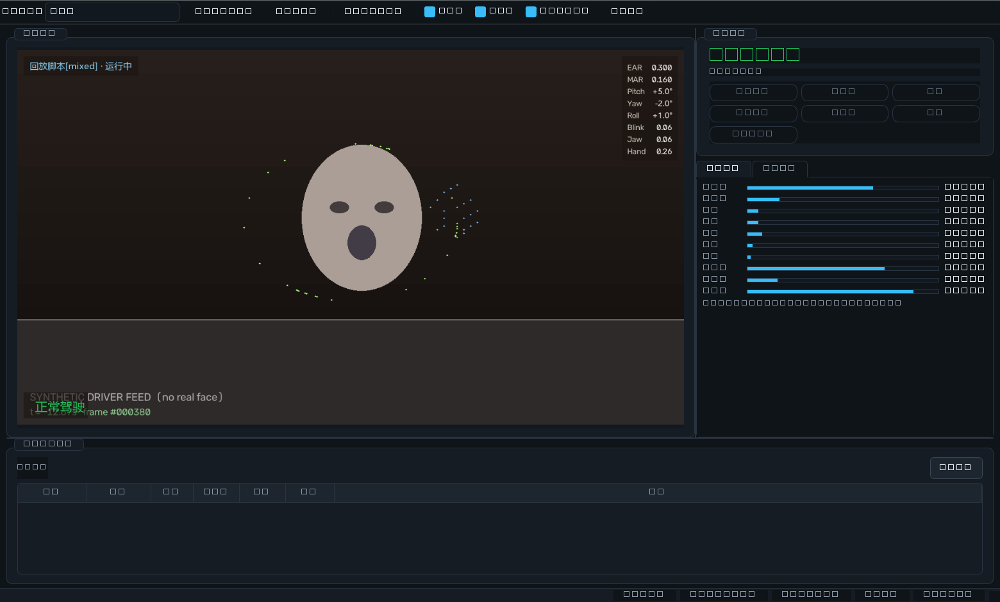
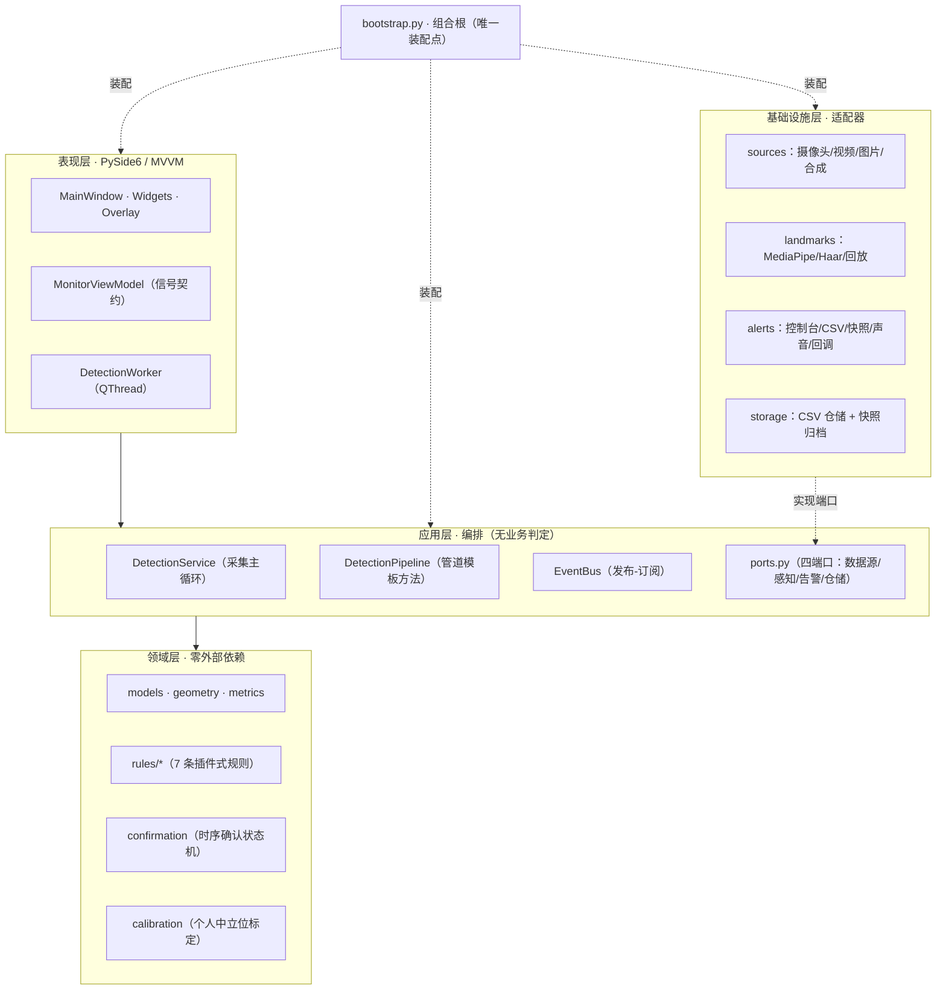

# DriverGuard · 驾驶员危险行为检测系统

> 软件体系结构课程设计项目 —— 一个基于计算机视觉、**可在无摄像头环境下完整演示与验证**的
> 驾驶员危险行为实时检测系统。系统只做**提示**，不参与任何车辆控制。

<p align="center">
  
  <br>
  <sub>综合演示脚本运行界面（画面由合成数据源生成，不含真实人像）</sub>
</p>

---

## 目录

- [1. 项目简介](#1-项目简介)
- [2. 检测能力](#2-检测能力)
- [3. 快速开始](#3-快速开始)
- [4. 命令行用法](#4-命令行用法)
- [5. 架构概览](#5-架构概览)
- [6. 目录结构](#6-目录结构)
- [7. 配置说明](#7-配置说明)
- [8. 测试与验证](#8-测试与验证)
- [9. 工具脚本](#9-工具脚本)
- [10. 交付文档](#10-交付文档)
- [11. 已知限制](#11-已知限制)

---

## 1. 项目简介

DriverGuard 用普通摄像头观察驾驶员面部与手部，实时判断 7 类危险行为并分级告警。
它同时记录可复核的证据（事件 CSV + 现场快照），供事后分析使用。

**为什么它值得一看**

| 特性 | 说明 |
| :--- | :--- |
| **无硬件也能验证** | 内置合成数据源 + 6 条离线演示脚本，没有摄像头、没有模型文件、甚至没有显示器都能完整跑通全链路并复现预期告警（**247 个自动化用例 + 1 个离线门禁脚本**） |
| **零误报为交付底线** | "正常驾驶 30 秒"脚本必须产生 **0 条**告警，并有离线门禁脚本自动验证（退出码即结论） |
| **个人中立位标定** | 不依赖第三方库的姿态角绝对语义，改为判定"相对该驾驶员中立位的偏离"，对摄像头安装角度与个体差异免疫 |
| **规则可插拔** | 新增一种危险行为 = 新增一个类 + 注册一行，**既有代码改动 0 处**；改阈值只需编辑 JSON |
| **安全与隐私固化在架构里** | 架构中**不存在**控制输出端口，也**不存在**任何网络输出适配器 |

---

## 2. 检测能力

| 行为 | 类别 | 主要判据 | 次要证据通道 |
| :--- | :--- | :--- | :--- |
| 闭眼疲劳 | 疲劳 | 眼睛纵横比 EAR | 眨眼表情系数 |
| 打哈欠 | 疲劳 | 嘴部纵横比 MAR | 张嘴表情系数 |
| 低头 | 疲劳/分心 | 相对中立位的俯仰偏离 | 眼-嘴纵向距离／脸宽（与轴系无关） |
| 视线偏离 | 分心 | 相对中立位的偏航／翻滚偏离 | — |
| 驾驶员离位 | 分心 | 持续 N 秒未检出人脸 | — |
| 打电话 | 违规 | 手部到面部的归一化距离 | 最短持续时长 |
| 抽烟 | 违规 | 手部到嘴部的归一化距离 | 最短持续时长 |

告警分级：`提示 / 关注 / 警告 / 严重`，每级对应不同的界面配色与提示音。

---

## 3. 快速开始

### 3.1 环境要求

- Windows 10/11（声音告警使用 `winsound`，其它平台自动降级为终端响铃）
- Python 3.10 ~ 3.11
- 可选：一个 USB 摄像头（没有也能演示）

### 3.2 安装

```bash
pip install -r requirements.txt
```

### 3.3 下载感知模型（可选，仅 MediaPipe 模式需要）

```bash
python tools/download_models.py
```

> 跳过这一步也可以运行——系统会给出明确提示，并可用 `--provider replay` 走回放模式。

### 3.4 启动

```bash
# 图形界面 + 摄像头（默认）
python run.py

# 没有摄像头？用回放模式（合成画面 + 内置演示脚本）
python run.py --source replay --provider replay --scenario mixed

# 只看有哪些演示脚本
python run.py --list-scenarios

# 环境自检（检查 Python 版本、依赖、模型、摄像头、字体）
python run.py --self-check

# 无界面模式（适合服务器/CI）
python run.py --source replay --provider replay --scenario fatigue --no-gui
```

---

## 4. 命令行用法

| 参数 | 说明 | 默认 |
| :--- | :--- | :--- |
| `--config PATH` | 指定配置文件 | `config/default.json` |
| `--source {camera,video,images,synthetic,replay}` | 数据源类型 | `camera` |
| `--provider {mediapipe,haar,replay}` | 感知实现 | `mediapipe` |
| `--scenario NAME` | 回放脚本名（见 `--list-scenarios`） | `mixed` |
| `--camera N` | 摄像头序号 | `0` |
| `--video PATH` | 视频文件路径 | — |
| `--images DIR` | 图片序列目录 | — |
| `--width/--height N` | 采集分辨率 | `1280x720` |
| `--fps N` | 目标帧率 | `30` |
| `--max-frames N` | 处理 N 帧后退出（配合 `--no-gui` 做脚本化验证） | 不限 |
| `--no-gui` | 不启动图形界面 | 关 |
| `--persist` | 持久化事件与快照到 `output/` | 关 |
| `--log-level LV` | `DEBUG/INFO/WARNING/ERROR` | `INFO` |
| `--list-scenarios` | 列出内置演示脚本及预期告警 | — |
| `--self-check` | 环境自检后退出 | — |

**常用组合**

```bash
# 用一段真实视频做批处理并落盘
python run.py --source video --video assets/samples/drive.mp4 --no-gui --persist

# 用图片序列做回归（每张图算一帧）
python run.py --source images --images assets/samples/frames --no-gui --max-frames 200

# 在低配机器上牺牲时间分辨率换取帧率
python run.py --width 640 --height 480 --fps 20
```

---

## 5. 架构概览

四种架构样式的组合：**分层**（主结构）+ **管道-过滤器**（检测链路）
+ **发布-订阅**（告警分发）+ **微内核插件**（规则）。



**检测链路（管道-过滤器）**

```
Frame → [F1 感知] → Observation → [F2 度量] → DriverMetrics
      → [F3 决策] → RuleOutcome → [F4 确认] → BehaviorEvent → 告警扇出
```

- **F1 感知**：MediaPipe（478 点人脸 / 21 点手部 / 头姿矩阵 / 表情系数）或降级/回放实现
- **F2 度量**：EAR、MAR、低头比例、头姿三轴、手-脸/手-嘴归一化距离（滑动窗口平滑）
- **F3 决策**：7 条规则并行评估，多证据通道融合，输出**无状态的瞬时判定**
- **F4 确认**：连续帧门槛 + 最短时长 + 迟滞释放 + 冷却，过滤抖动并抑制重复告警

**关键的依赖规则**：`presentation → application → domain`，
`infrastructure` 只通过**实现** `application/ports.py` 的接口被调用。
领域层没有任何外部依赖——这让 247 个测试用例可以在**没有摄像头、
没有模型、没有显示器**的环境下秒级跑完。

详细设计（4 种样式、参考模型、参考架构、16 处设计模式、25 个质量场景、
ADR-01~07、8 条架构不变量）见 [`docs/02-架构设计文档.md`](docs/02-架构设计文档.md)。

---

## 6. 目录结构

```text
无人驾驶/
├── run.py                     启动脚本（自动处理 sys.path）
├── requirements.txt
├── pyproject.toml
├── config/default.json        全部阈值与开关（改行为不改代码）
├── assets/
│   ├── models/                感知模型 .task（脚本下载，不入库）
│   └── cascades/              Haar 级联 .xml（降级通道用）
├── src/driver_guard/
│   ├── domain/                核心：值对象、几何、指标、规则、时序确认、标定
│   ├── application/           编排：端口、管道、事件总线、服务
│   ├── infrastructure/        适配器：数据源、感知、告警、存储
│   ├── presentation/          PySide6 界面（MVVM）：窗口、ViewModel、线程、叠加层
│   ├── bootstrap.py           组合根：唯一的依赖装配点
│   ├── config.py              配置加载 / 校验 / 范围夹紧
│   ├── app.py                 进程级引导（日志、Qt 应用）
│   └── main.py                命令行入口
├── tests/                     247 个用例，无硬件依赖
├── tools/                     模型下载 / 级联下载 / 自检 / 门禁 / 基准 / 截图
├── docs/                      四份课程文档 + 界面截图
└── output/                    运行期产出（事件 CSV、快照、日志）
```

---

## 7. 配置说明

所有阈值都在 `config/default.json`，改完**不需要改代码**：

```jsonc
{
  "perception": { "provider": "mediapipe", "scenario": "mixed" },
  "smoothing":  { "window": 9 },              // 指标滑动窗口（帧）
  "calibration": { "enabled": true, "required_samples": 30 },
  "rules": {
    "eyes_closed": {
      "enabled": true,
      "ear_threshold": 0.21,                  // 一律按"幅度"比较，写正值
      "trigger_frames": 6,                    // 连续命中帧数
      "min_duration": 1.2,                    // 最短持续时长（秒）
      "release_frames": 8,                    // 连续未命中多少帧才解除
      "cooldown_seconds": 8.0                 // 同一行为再次告警的间隔
    }
  }
}
```

**调参建议与语义约定**

| 想达到的效果 | 调整 |
| :--- | :--- |
| 减少误报 | 调保守阈值、增大 `trigger_frames` 与 `min_duration` |
| 减少漏报 | 放宽阈值、减小 `trigger_frames`；注意会牺牲误报率 |
| 告警太频繁 | 增大 `cooldown_seconds` |
| 告警一瞬即逝 | 增大 `release_frames` |
| 抖动/闪烁 | 增大 `smoothing.window`（代价：告警延迟上升 ≈ window ÷ fps 秒） |

> **约定**：所有阈值按**幅度（绝对值）**比较，请写正值。`pitch_threshold_deg: 18.0`
> 表示"偏离中立位 18 度"，而不是 -18 度。
>
> **改完请务必跑一次门禁**：`python tools/probe_scenarios.py`

**关于回放模式的结束时机**

`source.synthetic_duration = 0`（默认）在回放模式下表示"**自动对齐脚本长度**"，
即脚本跑完（例如 `mixed` 约 30 秒）会**自动收尾并弹出会话报告**。
若希望一直循环播放直到手动停止，把该值设为一个较大的秒数即可：

```jsonc
"source": { "synthetic_duration": 9999 }   // 回放模式下等效于"不自动结束"
```

---

## 8. 测试与验证

```bash
# 全部测试（无需摄像头/模型/显示器，秒级完成）
python -m pytest tests/ -q

# 演示脚本回归门禁：6 条脚本必须产生"恰好符合预期"的告警集合
python tools/probe_scenarios.py

# 端到端冒烟（合成数据源 + 回放感知，关闭声音）
python tools/smoke_test.py

# 分阶段性能实测
python tools/benchmark.py --image <含人脸的图片> --sizes 640x480 960x540 1280x720

# 离屏跑界面并生成截图到 docs/images/
python tools/capture_ui.py
```

**测试分层**

| 文件 | 覆盖内容 |
| :--- | :--- |
| `test_geometry.py` | EAR/MAR 公式、欧拉角分解、往返精度（1e-9）、小角度叠加性质、万向锁、退化输入 |
| `test_metrics.py` | 用合成人脸/手部几何验证各指标的数值正确性与降级行为 |
| `test_domain_rules.py` | 7 条规则、规则引擎容错、时序确认状态机、中立位标定 |
| `test_application.py` | 事件总线、流水线、检测/告警/统计服务、CSV 仓储、快照归档、配置 |
| `test_integration.py` | 真实装配 + 6 条演示脚本门禁 + 数据源/感知工厂 + 叠加层渲染 |

---

## 9. 工具脚本

| 脚本 | 用途 |
| :--- | :--- |
| `tools/download_models.py` | 下载 MediaPipe `.task` 模型到 `assets/models/` |
| `tools/fetch_cascades.py` | 下载 Haar 级联 XML 到 `assets/cascades/`（降级感知通道） |
| `tools/probe_scenarios.py` | **回归门禁**：跑完 6 条演示脚本并断言告警集合，退出码即结论 |
| `tools/smoke_test.py` | 端到端冒烟测试 |
| `tools/benchmark.py` | 分阶段耗时基准（按分辨率） |
| `tools/capture_ui.py` | 离屏运行界面并导出截图 |

---

## 10. 交付文档

| 文档 | 内容 |
| :--- | :--- |
| [`docs/00-封面与分工.md`](docs/00-封面与分工.md) | 封面、项目名称、班号-学号-姓名、每人工作与进度 |
| [`docs/01-需求规格说明书.md`](docs/01-需求规格说明书.md) | **功能 / 质量 / 限制条件** 需求、MoSCoW 优先级、完整需求追溯矩阵、验收标准 |
| [`docs/02-架构设计文档.md`](docs/02-架构设计文档.md) | **架构样式 · 参考模型 · 参考架构 · 质量场景 · 框架 · 设计模式 · 优先级划分**、五视图、ADR-01~07、实测性能 |
| [`docs/03-架构评审文档.md`](docs/03-架构评审文档.md) | **质量属性效用树 · 权衡点 · 风险点**、敏感点/非风险点、ATAM 分析备忘录、风险登记册 |
| [`docs/04-心得体会.md`](docs/04-心得体会.md) | 三位成员的技术反思与方法论总结 |

---

## 11. 已知限制

本系统是**课程设计作品**，不是功能安全认证产品，请勿用于对驾驶员进行考核或处罚。

| 限制 | 说明 |
| :--- | :--- |
| **不参与车辆控制** | 架构中不存在控制输出端口（不变量 INV-7），本系统只提示 |
| **不做网络上传** | 架构中不存在网络输出适配器，全部数据本地存储 |
| **精度未做定量评估** | 只有脚本级功能验证，未采集真实驾驶数据做混淆矩阵（技术债 TD-1） |
| **单人假设** | 只检测画面中的主驾驶员 |
| **手部判据为二维归一化距离** | 侧脸或手在脸后方时可能误判（技术债 TD-2） |
| **未覆盖全部违法情形** | 不含"双手离把""未系安全带"（需额外区域检测模型，TD-3/TD-4） |
| **依赖体积较大** | PySide6 ≈ 240 MB + MediaPipe ≈ 100 MB |
| **需要可见光** | 夜间/强逆光下误报率上升；建议照度 ≥ 50 lux |

---

## 许可与致谢

本项目为课程作业，供学习交流使用。使用的开源组件：
[OpenCV](https://opencv.org/)、[MediaPipe](https://developers.google.com/mediapipe)、
[NumPy](https://numpy.org/)、[PySide6](https://doc.qt.io/qtforpython/)、
[Pillow](https://python-pillow.org/)、[pytest](https://pytest.org/)。
