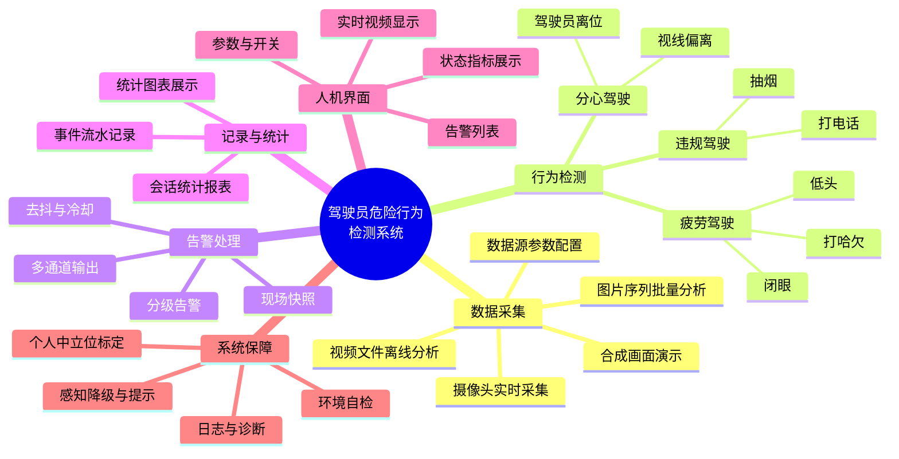
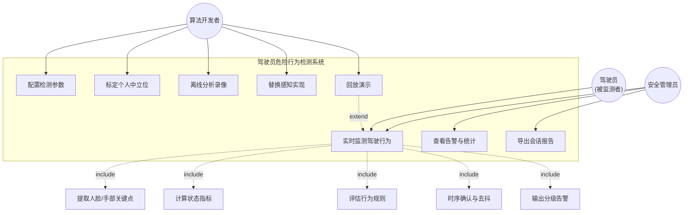

# 驾驶员危险行为检测系统 —— 需求规格说明书

| 项 | 内容 |
| :--- | :--- |
| 文档编号 | SA-2024-DMS-01-SRS |
| 版本 | v1.1 |
| 日期 | 2026-09-22 |
| 编写 | 【姓名】（组长） |
| 评审 | 全体小组成员 |
| 状态 | 已基线（第 3 周需求迭代后冻结） |

**修订记录**

| 版本 | 日期 | 修订内容 | 修订人 |
| :---: | :--- | :--- | :--- |
| v1.0 | 第 2 周 | 初稿：功能需求、质量需求、限制条件 | 组长 |
| v1.1 | 第 3 周 | 迭代：① 新增「回放演示模式」需求（无摄像头可验收）；② 新增「驾驶员个人中立位标定」需求（解决姿态阈值个体差异）；③ 明确告警去抖与冷却的可验收指标；④ 补充需求追踪矩阵 | 组长 |

---

## 1. 引言

### 1.1 编写目的

本文档定义**驾驶员危险行为检测系统**（下称"本系统"）的完整需求，作为架构设计、编码实现、
测试验收与架构评审的共同依据。读者对象为：

* 项目组成员 —— 明确"做什么"与"做到什么程度"；
* 指导教师与评审人 —— 判断需求是否完整、可验证、优先级合理；
* 后续维护者 —— 理解每项功能的业务动机。

### 1.2 项目范围

**范围内（In Scope）**

* 基于单目可见光摄像头的**非接触式**驾驶员行为检测；
* 7 类危险行为的实时识别与分级告警；
* 告警事件的记录、快照存档与统计报表；
* 桌面图形界面（Windows / Linux）；
* 一套可离线、可复现的演示与自检机制。

**范围外（Out of Scope）**

* 车辆控制类动作（如自动减速、靠边停车）—— 本系统**只检测与告警，不参与控制**；
* 多摄像头融合、红外/深度摄像头、夜间无光环境；
* 云端上传、车联网通信、后台大数据分析；
* 模型训练与数据集采集（本项目直接使用 MediaPipe 预训练模型）；
* 功能安全认证（不满足 ISO 26262 等汽车功能安全等级要求），**仅作为课程原型**。

### 1.3 术语与缩写

| 术语 | 全称 / 含义 |
| :--- | :--- |
| DMS | Driver Monitoring System，驾驶员监控系统 |
| EAR | Eye Aspect Ratio，眼睛纵横比，用于判断睁眼/闭眼 |
| MAR | Mouth Aspect Ratio，嘴部纵横比，用于判断打哈欠 |
| 关键点 | Facial Landmark，面部特征点；MediaPipe FaceMesh 提供 478 个 |
| blendshape | 表情/动作系数（0~1），如 `eyeBlinkLeft`、`jawOpen` |
| 中立位 | 驾驶员在正常坐姿、目视前方时的头部姿态基准值 |
| 去抖 | 通过"连续 N 帧成立"等方式抑制瞬时误判 |
| 迟滞 | 触发与解除使用不同阈值/条件，避免状态抖动 |
| 效用树 | Utility Tree，ATAM 中用于组织质量属性场景的树形结构 |

### 1.4 参考资料

1. ISO/IEC 25010:2011 —— 系统与软件质量模型（质量属性分类依据）
2. SEI, *Architecture Tradeoff Analysis Method (ATAM)* —— 架构评审方法
3. Soukupová T., Čech J. (2016). *Real-Time Eye Blink Detection using Facial Landmarks* —— EAR 判据来源
4. MediaPipe Face Landmarker / Hand Landmarker 官方文档 —— 感知能力边界依据
5. 《中华人民共和国道路交通安全法实施条例》第六十二条 —— 驾驶时禁止拨打接听手持电话、观看电视等
6. 项目组前期调研记录（2026-09-08 ~ 09-15，含 3 位驾驶员访谈）

---

## 2. 项目概述

### 2.1 业务背景

疲劳驾驶与分心驾驶是道路交通事故的主要诱因之一。据统计，我国每年因疲劳驾驶直接导致的
交通事故占重特大交通事故的 **10%~20%**，且疲劳驾驶的**致死率显著高于其他违法类型**
——因为驾驶人在疲劳状态下往往已经失去采取规避动作的能力。

现有治理手段存在明显缺口：

| 手段 | 局限 |
| :--- | :--- |
| 法规约束（连续驾驶不超过 4 小时） | 只能管"时长"，管不了实际生理状态；执法成本高 |
| 路侧卡口抓拍 | 只能抓"手持电话"等外显行为，无法识别疲劳 |
| 高端商用 DMS（整车前装） | 成本高、封闭、需专业标定，难以在教学与后装场景落地 |

本项目的目标是做一个**低成本、可解释、可二次开发**的检测系统原型，
在普通笔记本 + USB 摄像头的条件下即可运行，用于课程演示与后续研究。

### 2.2 系统目标

| 编号 | 目标 | 可度量的成功判据 |
| :--- | :--- | :--- |
| G1 | 实时识别 7 类危险行为 | 每条行为规则均有离线脚本可复现触发的自动化测试 |
| G2 | 满足实时性要求 | 单帧端到端处理耗时中位数 ≤ 80 ms（CPU 2 核 @2.4 GHz 等效），显示帧率 ≥ 20 FPS |
| G3 | 误报可控 | 内置"正常驾驶"脚本连续运行 30 秒，**零告警** |
| G4 | 无硬件也能验收 | 在无摄像头环境下，通过回放模式可完整演示"检测—告警—统计—报告"全链路 |
| G5 | 架构可讲清楚 | 每个架构决策均有 ADR 记录，每项质量属性均有场景与实测数据支撑 |
| G6 | 可扩展 | 新增一种危险行为只需新增 1 个规则类 + 1 行注册，不改动既有代码 |

### 2.3 用户特征

| 用户角色 | 特征 | 主要诉求 |
| :--- | :--- | :--- |
| **驾驶员**（被监测者） | 非技术用户，注意力集中在道路上 | 告警要"听得懂、不烦人"；不能遮挡视线；不能误判导致反感 |
| **车队安全管理员** | 需要事后追溯与统计 | 事件可查、可按行为/时间统计、有现场快照可复核 |
| **算法/集成开发者** | 具备 Python 基础 | 接口清晰、可替换感知实现、可自定义规则阈值、有测试可跑 |
| **课程评审人** | 关注架构与工程规范 | 架构决策有据可查、文档与代码一致、可独立复现运行 |

### 2.4 运行环境

| 类别 | 要求 |
| :--- | :--- |
| 操作系统 | Windows 10/11（主）；Linux（次，需系统 CJK 字体） |
| Python | 3.10 ~ 3.12 |
| 硬件（最低） | 双核 CPU @2.0 GHz、4 GB 内存、USB 2.0 摄像头（720p@30fps 以下） |
| 硬件（推荐） | 四核 CPU、8 GB 内存、1080p 摄像头 |
| 依赖库 | OpenCV、NumPy、MediaPipe、PySide6 |
| 磁盘 | ≥ 500 MB（含模型 11 MB、快照与日志） |
| 网络 | **运行期不需要**（模型一次性下载后离线可用） |

### 2.5 约束与假设

**约束（Constraint）**

| 编号 | 约束 | 来源 |
| :--- | :--- | :--- |
| C1 | 实现语言限定 Python（组员技术栈） | 课程/团队约定 |
| C2 | 不得使用需联网的云推理服务 | 车载环境下网络不可靠；课程演示环境受限 |
| C3 | 必须在无摄像头环境下也能演示与验收 | 答辩现场风险控制 |
| C4 | 交付周期 6 周，人力 3 人（含文档时间） | 课程进度表 |
| C5 | 不做模型训练，只做推理与规则融合 | 无标注数据集与算力 |
| C6 | 单帧不得阻塞界面超过 100 ms | 界面可用性底线 |

**假设（Assumption）**

| 编号 | 假设 | 若不成立的影响 |
| :--- | :--- | :--- |
| A1 | 摄像头安装于仪表台/方向盘前方，能拍到驾驶员正面或 3/4 侧脸 | 人脸检测失败率上升，需重新设计安装方案 |
| A2 | 白天或车内照明充足（照度 ≥ 50 lux） | 夜间误报率上升；需引入红外补光 |
| A3 | 画面中只有一名主要驾驶员 | 需要增加身份区分逻辑 |
| A4 | 会话开始时驾驶员处于正常坐姿（用于中立位标定） | 标定基准被污染，可点"重新标定"恢复 |
| A5 | 摄像头位置在一次会话内固定 | 中立位基准失效，需重新标定 |

---

## 3. 功能需求

### 3.1 功能结构



### 3.2 功能需求清单

需求编号规则：`FR-<模块>-<序号>`；优先级采用 MoSCoW（见 3.5 节）。

#### 模块 FR-A：数据采集

| 编号 | 需求描述 | 优先级 | 验收标准 |
| :--- | :--- | :---: | :--- |
| FR-A-01 | 系统应支持从 USB 摄像头实时采集视频流 | M | 能打开 `--camera 0` 并稳定输出 ≥ 15 FPS 的画面 |
| FR-A-02 | 系统应支持从视频文件读取并分析（离线模式） | M | `--source video --video x.mp4` 可跑完并输出报告 |
| FR-A-03 | 系统应支持从图片序列批量分析 | S | `--source images --images dir` 按文件名顺序处理 |
| FR-A-04 | 系统应提供**合成画面**数据源，不需要任何硬件 | M | `--source synthetic` 能持续输出画面且不报错 |
| FR-A-05 | 系统应支持播放到视频结尾后循环，便于长时间演示 | C | `loop_video=true` 时视频到结尾自动重播 |
| FR-A-06 | 采集分辨率、帧率、摄像头序号应可配置（配置文件 + 命令行） | S | 命令行参数优先于配置文件，且能在日志中确认生效值 |
| FR-A-07 | 数据源打开失败时，应给出**可操作**的错误提示而非崩溃 | M | 拔掉摄像头后启动，界面提示"无法打开数据源：摄像头 #0"且程序不退出 |

#### 模块 FR-B：感知（关键点提取）

| 编号 | 需求描述 | 优先级 | 验收标准 |
| :--- | :--- | :---: | :--- |
| FR-B-01 | 应能提取 478 点人脸关键点 | M | 对同一帧，提取点数 = 478 且归一化坐标 ∈ [0,1] |
| FR-B-02 | 应能提取手部 21 点关键点 | M | 手入镜时返回 1~2 只手的关键点 |
| FR-B-03 | 应能输出头部姿态（俯仰/偏航/翻滚三个角） | M | 输出三个有限实数值；叠加已知旋转后读数同向变化 |
| FR-B-04 | 应能输出表情/动作系数（眨眼、张口） | S | 输出 `eyeBlinkLeft/Right`、`jawOpen`，取值 ∈ [0,1] |
| FR-B-05 | 感知实现应可替换（MediaPipe / Haar / 回放） | S | 通过 `--provider` 切换，上层规则代码零改动 |
| FR-B-06 | 手部模型缺失时，应自动关闭手部通道并**明确提示**，其余功能不受影响 | M | 删除 `hand_landmarker.task` 后仍能启动，界面提示"打电话/抽烟检测已关闭" |
| FR-B-07 | 模型文件缺失时，应提示具体路径与下载命令 | M | 提示文案包含文件名与 `python tools/download_models.py` |
| FR-B-08 | 支持的检测距离：摄像头到人脸 50 ~ 120 cm | S | 该范围内人脸检出率 ≥ 95%（30 次取样） |
| FR-B-09 | 支持的头部偏转范围：偏航 ±50° 内 | C | 超出范围允许检不到，不产生错误告警 |

#### 模块 FR-C：疲劳驾驶检测

| 编号 | 需求描述 | 优先级 | 验收标准 |
| :--- | :--- | :---: | :--- |
| FR-C-01 | **闭眼疲劳**：持续闭眼超过 1.2 秒应告警 | M | 回放 `fatigue` 脚本触发 `eyes_closed` |
| FR-C-02 | 闭眼判定应同时使用 EAR 与眨眼系数两条通道 | S | 任一条通道数据缺失时仍能判定（单元测试覆盖） |
| FR-C-03 | 两通道结论冲突时，应触发但降低置信度 | C | 冲突场景置信度 < 一致场景置信度（单元测试覆盖） |
| FR-C-04 | **打哈欠**：嘴部张开幅度持续超过阈值应告警 | M | 回放 `fatigue` 脚本触发 `yawning` |
| FR-C-05 | 应能区分"打哈欠"与"说话" | M | 说话（MAR≈0.3）不触发；打哈欠（MAR≈0.7）触发 |
| FR-C-06 | **低头**：头部向下偏离中立位超过 18°，或脸部纵向透视压缩比下降超过 0.06，持续 1.5 秒应告警 | M | 回放 `fatigue`/`distraction` 脚本触发 `head_down` |
| FR-C-07 | 低头判定应有一条**不依赖旋转矩阵轴系**的独立通道 | S | 单独构造指标使俯仰角不可用，规则仍可触发（单元测试覆盖） |

#### 模块 FR-D：分心驾驶检测

| 编号 | 需求描述 | 优先级 | 验收标准 |
| :--- | :--- | :---: | :--- |
| FR-D-01 | **视线偏离**：头部水平偏离中立位 > 25° 或倾斜 > 22°，持续 1.8 秒应告警 | M | 回放 `distraction` 脚本触发 `gaze_off_road` |
| FR-D-02 | 左右偏转的判定应完全对称 | M | 左偏 40° 与右偏 40° 的置信度相等（单元测试覆盖） |
| FR-D-03 | **驾驶员离位**：连续 3 秒未检测到人脸应告警 | M | 回放 `absent` 脚本触发 `driver_absent` |
| FR-D-04 | 驾驶员返回座位后应立即停止计时 | S | 无人 2.9 s → 有人 0.5 s → 再无人 0.5 s，不触发 |

#### 模块 FR-E：违规驾驶检测

| 编号 | 需求描述 | 优先级 | 验收标准 |
| :--- | :--- | :---: | :--- |
| FR-E-01 | **打电话**：手部关键点到脸中心的最小距离（以脸宽归一化）< 0.55，持续 1.0 秒应告警 | M | 回放 `violation` 脚本触发 `phone_call` |
| FR-E-02 | **抽烟**：手部关键点到嘴中心的最小距离（以脸宽归一化）< 0.35，持续 2.5 秒应告警 | M | 回放 `violation` 脚本触发 `smoking` |
| FR-E-03 | 距离判据应对摄像头距离不敏感 | S | 同一相对姿态下，距离变化 2 倍时归一化距离偏差 < 0.05（单元测试覆盖） |
| FR-E-04 | 打电话与抽烟应使用不同判据以免互相混淆 | S | 手贴脸但远离嘴时只触发打电话（单元测试覆盖） |

#### 模块 FR-F：告警处理

| 编号 | 需求描述 | 优先级 | 验收标准 |
| :--- | :--- | :---: | :--- |
| FR-F-01 | 告警应分级：提示/轻微/中等/严重/危急 五级 | M | 每条规则可独立配置级别；界面按级别配色 |
| FR-F-02 | 告警应支持多种输出通道：日志、CSV、声音、现场快照、界面 | M | 各通道可独立开关；通道故障不影响其它通道 |
| FR-F-03 | 声音告警应按级别使用不同鸣响模式（次数/音高） | S | 危急 = 3 声高音；严重 = 2 声中音；中等 = 1 声低音 |
| FR-F-04 | 应通过"连续帧门槛 + 最短时长 + 迟滞释放"抑制误报 | M | 单帧事件不触发；单帧丢失不丢事件（单元测试覆盖） |
| FR-F-05 | 同一行为持续期间应按冷却时间重复提醒，避免告警轰炸 | M | 冷却期内不重复；冷却期外以"持续"标记重复提醒 |
| FR-F-06 | 严重告警应保存现场快照，且在图像上标注时间/行为/置信度 | M | 快照文件包含可读水印；目录文件数受配额限制 |
| FR-F-07 | 同一持续行为的重复提醒不应重复保存快照 | S | 一次 30 秒回放产生的快照数 ≤ 告警行为数 |
| FR-F-08 | 应支持"仅告警不播报"的静默模式 | C | 关闭声音通道后系统行为完全一致 |

#### 模块 FR-G：记录与统计

| 编号 | 需求描述 | 优先级 | 验收标准 |
| :--- | :--- | :---: | :--- |
| FR-G-01 | 每条告警应记录：时间、行为、级别、置信度、持续时长、帧号、说明、指标明细 | M | CSV 含 14 列；重启后历史记录可被正确读回 |
| FR-G-02 | 应提供按行为、按大类（疲劳/分心/违规）、按级别的统计 | M | 三类统计之和与事件总数一致 |
| FR-G-03 | 应提供实时统计条形图 | S | 事件发生后 1 秒内图表更新 |
| FR-G-04 | 每次会话结束应输出会话汇总（帧数、时长、平均帧率、风险指数、各阶段耗时） | M | 汇总写入 `sessions.csv` 并在界面弹出报告 |
| FR-G-05 | 应提供"风险指数"用于会话间横向对比 | C | 取值 ∈ [0,100]；时长 ≤ 0 时返回 0（单元测试覆盖） |
| FR-G-06 | 应支持把当前会话报告导出为文本文件 | C | 导出文件内容与界面弹窗一致 |
| FR-G-07 | 指标与告警记录中的数值必须真实，不得被标志位覆盖 | M | 记录中 `ear`/`mar` 等为真实测量值（单元测试覆盖） |

#### 模块 FR-H：人机界面

| 编号 | 需求描述 | 优先级 | 验收标准 |
| :--- | :--- | :---: | :--- |
| FR-H-01 | 应实时显示视频画面，并叠加人脸框、关键点、指标 HUD | M | 三个叠加元素可独立开关 |
| FR-H-02 | 画面显示应保持宽高比，**不得拉伸** | M | 16:9 画面在 4:3 控件中显示为上下留黑边 |
| FR-H-03 | 应以大号文字显示当前状态结论（正常 / 检测到危险行为 / 未检测到驾驶员 / 标定中） | M | 四种状态各有独立配色，1 秒内响应状态变化 |
| FR-H-04 | 应用色块/文字高亮当前激活的危险行为及置信度 | M | 激活行为以对应级别颜色高亮 |
| FR-H-05 | 应显示状态指标（EAR/MAR/头姿/手距）及相对阈值的进度条 | S | 指标不可用时显示 `—` 而非 `0` |
| FR-H-06 | 应提供告警事件列表，新事件插入顶部，同一持续行为合并为一行 | M | 30 秒演示后列表行数 ≤ 告警行为数 + 数据源切换次数 |
| FR-H-07 | 应提供开始/停止/重新标定等操作入口 | M | 支持 F5 开始、F6 停止快捷键 |
| FR-H-08 | 界面中文必须正确显示（不得出现方块或 `???`） | M | 所有中文标签在 Windows 下正常显示 |
| FR-H-09 | 界面不得因检测线程异常而卡死或崩溃 | M | 感知抛异常时界面显示错误提示，操作按钮恢复可用 |
| FR-H-10 | 应支持在无显示器环境（离屏模式）下启动与截图 | C | `QT_QPA_PLATFORM=offscreen` 可运行并产出 PNG |

#### 模块 FR-I：系统保障

| 编号 | 需求描述 | 优先级 | 验收标准 |
| :--- | :--- | :---: | :--- |
| FR-I-01 | 会话开始时应自动标定驾驶员个人中立位 | M | 约 1 秒（30 帧）内完成，界面显示标定进度 |
| FR-I-02 | 标定应使用**中位数**而非均值以抵抗离群帧 | S | 混入 1 帧 20° 偏头时基准偏移 < 1°（单元测试覆盖） |
| FR-I-03 | 标定期间驾驶员大幅偏头时，该帧不参与标定 | S | 偏转 > 35° 的帧被剔除（单元测试覆盖） |
| FR-I-04 | 应支持手动触发重新标定 | S | 点击后重新学习，界面给出提示 |
| FR-I-05 | 未完成标定时，头部姿态相关规则应**跳过**而非使用固定阈值误判 | M | 未标定时 `head_down` / `gaze_off_road` 不触发（单元测试覆盖） |
| FR-I-06 | 应提供环境自检命令，检查模型、级联、依赖、输出目录 | S | `--self-check` 输出逐项 ✓/✗ 并以退出码表示结果 |
| FR-I-07 | 应提供离线脚本验证工具，验证各演示脚本能否触发预期规则 | S | `tools/probe_scenarios.py` 退出码 0 表示全部符合预期 |
| FR-I-08 | 日志应同时输出到控制台与滚动文件（单文件 2 MB，保留 3 份） | S | 长时间运行不会写满磁盘 |
| FR-I-09 | 单条规则抛出异常时，应隔离该规则并继续运行其余规则 | M | 注入必崩规则后，其余规则仍正常产出告警（单元测试覆盖） |
| FR-I-10 | 配置文件出现未知键或非法值时，应告警并夹紧到合法范围，而非静默忽略 | S | `fps=100000` 被夹紧到 240 并产生告警（单元测试覆盖） |
| FR-I-11 | 应提供无界面批量模式，便于自动化与服务器端分析 | C | `--no-gui` 跑完并打印汇总，退出码表示成功/失败 |

### 3.3 用例模型

#### 3.3.1 用例图



#### 3.3.2 核心用例规格：UC1 实时监测驾驶行为

| 项 | 内容 |
| :--- | :--- |
| **用例编号** | UC1 |
| **参与者** | 驾驶员（被动）、安全管理员（主动） |
| **前置条件** | ① 摄像头可用或已选择其它数据源；② 感知模型文件就绪；③ 配置文件合法 |
| **触发条件** | 用户点击"开始检测"或按 F5 |
| **后置条件** | 会话结束后：事件写入 CSV、会话汇总写入 sessions.csv、严重告警有快照存档 |
| **优先级** | 必须（M） |

**基本流程**

| 步骤 | 参与者动作 | 系统响应 |
| :---: | :--- | :--- |
| 1 | 点击"开始检测" | 装配应用组件、加载模型、显示"正在启动…" |
| 2 | — | 启动采集线程，逐帧读取视频 |
| 3 | — | 对每帧提取人脸/手部关键点与头姿矩阵 |
| 4 | — | 由关键点计算 EAR / MAR / 低头比例 / 手距等指标 |
| 5 | — | 在滑动窗口上平滑指标，抑制关键点抖动 |
| 6 | — | 会话前 30 个有效帧完成个人中立位标定，界面显示进度 |
| 7 | — | 全部规则并行评估，得到瞬时判定结果 |
| 8 | — | 时序确认：连续帧门槛 → 最短时长 → 迟滞释放 → 冷却 |
| 9 | — | 确认后的行为以事件形式发布到事件总线 |
| 10 | — | 各告警通道输出（日志/CSV/声音/快照/界面）同时更新界面显示 |
| 11 | 点击"停止"（或数据源结束） | 停止采集、释放资源、输出会话报告 |

**扩展流程**

| 编号 | 条件 | 处理 |
| :--- | :--- | :--- |
| 3a | 未检测到人脸 | 跳过行为规则，驱动 `driver_absent` 计时；界面显示"未检测到驾驶员" |
| 3b | 感知抛异常 | 记录日志并跳过该规则/该帧；累计失败次数；界面不中断 |
| 7a | 某条规则抛异常 | 隔离该规则（记日志 + 计数），其余规则照常执行 |
| 2a | 数据源打开失败 | 界面提示可操作信息，状态置为"异常"，按钮恢复可用 |
| 2b | 视频播放结束 | 状态置为"已完成"，可点击开始重放 |
| 6a | 标定期间驾驶员离开 | 复用已采集样本，或提示重新标定 |
| 8a | 行为短暂中断后又出现 | 未达释放帧数则视为同一次持续行为，不重复计为新事件 |

### 3.4 数据需求

| 数据对象 | 内容 | 存放 | 生命周期 |
| :--- | :--- | :--- | :--- |
| 告警事件 | 14 个字段（时间、行为、级别、置信度、时长、指标明细…） | `output/events/events.csv` | 追加保存；界面列表上限可配置 |
| 会话汇总 | 会话级统计与性能数据 | `output/events/sessions.csv` | 每次会话追加一行 |
| 现场快照 | 标注水印的 JPEG | `output/snapshots/` | 上限 2000 张，超出删最旧 |
| 运行日志 | 分级日志 | `output/driver_guard.log` | 滚动，2 MB × 4 |
| 配置 | 阈值与开关 | `config/default.json` | 人工维护；未知键会告警 |
| 感知模型 | `.task` 模型文件 | `assets/models/` | 一次性下载，运行期只读 |

**数据保留与隐私**

* 本系统产生的人脸图像、关键点与行为记录属于**个人敏感信息**；
* 快照默认本地存储、不上传；演示与交付时需征得被拍摄者同意；
* 交付文档中使用的界面截图均由**合成画面/预置回放脚本**生成，不含真实人像。

---

## 4. 质量需求（非功能需求）

质量需求按 ISO/IEC 25010 分类，全部以**可度量的场景**形式给出，
以便架构评审（ATAM）时评级并作为验收依据。

### 4.1 质量属性场景汇总

| 编号 | 属性 | 场景（6 要素） | 度量与验收 |
| :--- | :--- | :--- | :--- |
| **QA-1** | 性能（实时性） | 采集线程在普通双核 CPU 上以 30 FPS 输入 720p 视频时 | 单帧端到端处理 **中位数 ≤ 80 ms**；显示帧率 ≥ 20 FPS；采集不因界面渲染而阻塞 |
| **QA-2** | 性能（低算力降级） | 在低配机器上帧率不足时 | 可通过 `frame_stride` 隔帧推理，帧率提升 ≥ 40% 而告警不丢失（时长门槛仍生效） |
| **QA-3** | 可靠性（误报抑制） | 驾驶员正常驾驶 30 秒（含眨眼、说话、正常转头） | **零告警**（`tools/probe_scenarios.py --scenario normal` 通过） |
| **QA-4** | 可靠性（漏报抑制） | 驾驶员闭眼疲劳 5 秒 | 在闭眼开始后 **≤ 1.5 s** 内产生 `eyes_closed` 告警，且 5 秒内至少 1 次 |
| **QA-5** | 可靠性（单点故障隔离） | 任一规则插件抛出异常 | 其余规则照常工作，采集循环不中断，异常次数被记录并可观测 |
| **QA-6** | 可用性（无硬件可演示） | 答辩现场无摄像头 | 通过回放模式完整演示全链路，界面明确标注"合成画面/回放模式" |
| **QA-7** | 可用性（降级可感知） | 手部模型文件缺失 | 系统正常启动，界面提示"打电话/抽烟检测已关闭"，其余 5 类行为检测不受影响 |
| **QA-8** | 可用性（错误可理解） | 摄像头被占用 | 提示包含具体原因与可能的原因方向；程序不退出；用户可直接重试 |
| **QA-9** | 易用性 | 安全管理员首次使用 | 无需培训即可在 3 步内完成"启动 → 观察 → 查看告警"；状态结论用大号文字直给 |
| **QA-10** | 易用性（注意力友好） | 告警发生时驾驶员正在驾驶 | 告警以"声音 + 色块"双重编码；严重级别越高提示越强；同一行为不连续轰炸 |
| **QA-11** | 可修改性（新增行为） | 需要新增"未系安全带"检测 | 只需新增 1 个规则类 + 1 行注册 + 1 段配置，**既有文件改动数 = 0** |
| **QA-12** | 可修改性（替换感知） | 需要把 MediaPipe 换成自研模型 | 只需新增 1 个 `LandmarkProvider` 实现 + 1 行工厂注册，规则层零改动 |
| **QA-13** | 可修改性（调整阈值） | 某地法规对疲劳判定更严格 | 只改 `config/default.json`，无需改代码、无需重新测试业务逻辑 |
| **QA-14** | 可测试性 | 在无摄像头、无模型、无显示器的 CI 环境中 | 全部自动化测试在 **≤ 60 s** 内跑完；核心算法测试不加载模型 |
| **QA-15** | 可测试性（时序可控） | 需要验证去抖与迟滞逻辑 | 使用假时钟与构造指标，时序行为**完全可复现**（不依赖真实时间） |
| **QA-16** | 安全性（人身） | 系统工作期间 | **不产生任何车辆控制指令**；不遮挡驾驶员视野；告警音量不引起惊扰 |
| **QA-17** | 安全性（数据） | 记录含人像数据 | 全部本地存储、不上传；快照数量有配额；交付文档不含真实人像 |
| **QA-18** | 可移植性 | 从 Windows 迁移到 Linux | 除系统字体外无需改代码；中文字体缺失时自动退化为英文标签而非乱码 |
| **QA-19** | 可观测性 | 需要定位"为什么没告警" | 每帧各阶段耗时、各指标实时值、各规则命中明细、订阅者异常次数均可查看 |
| **QA-20** | 可维护性（文档一致性） | 维护者阅读代码 | 关键架构决策有 ADR；每个模块头部说明"为什么这样设计"；领域层零外部依赖 |

### 4.2 关键质量需求的量化指标汇总

| 指标 | 目标值 | 测量方法 |
| :--- | :--- | :--- |
| 单帧处理耗时（中位数） | ≤ 80 ms | 流水线四阶段累加耗时，会话汇总输出均值 |
| 显示帧率 | ≥ 20 FPS | 界面状态栏实时 FPS |
| 告警延迟（闭眼） | ≤ 1.5 s | 回放脚本中"闭眼开始时刻"到首次告警时间的差 |
| 正常驾驶误报 | 0 次 / 30 s | `probe_scenarios.py --scenario normal` |
| 规则覆盖 | 7/7 类行为均有可复现的自动化用例 | `pytest tests/test_integration.py -k scenario` |
| 无线程泄漏 | 连续 3 次"开始→停止"后线程数不增长 | 手动 + `test_start_async_rejects_double_start` |
| 内存增长 | 连续运行 10 分钟不持续增长 | 观察进程 RSS（滑动窗口有长度上限） |
| 自动化测试规模 | ≥ 100 个用例，全部通过 | `pytest tests/ -q` |
| 首次启动到出画面 | ≤ 5 s（含模型加载） | 手动计时 |
| 停止响应时间 | ≤ 1 s | `test_stop_interrupts_loop`（3 s 超时上限） |

---

## 5. 限制条件

### 5.1 技术限制

| 编号 | 限制 | 影响与应对 |
| :--- | :--- | :--- |
| L1 | 单目 RGB 摄像头无法测量真实三维尺度 | 所有判据使用**归一化比值**（EAR、MAR、以脸宽归一化的距离），避免绝对尺寸 |
| L2 | MediaPipe 规范模型的轴系与 OpenCV 相机轴系不一致，且官方未说明 | **不依赖绝对姿态角语义**，改用"相对个人中立位的偏离量"判定（详见架构文档 ADR-05） |
| L3 | 关键点 z（深度）是相对估计值，不是公制深度 | 三维证据只用于"哪一侧更近"这类定性判断，不用于绝对距离 |
| L4 | 无握方向盘/安全带检测能力（缺少方向盘区域与人体姿态模型） | 明确列为范围外，避免夸大能力 |
| L5 | 光照敏感：逆光、夜间、强阴影下检出率下降 | 假设 A2 约束使用环境；降级通道与"未检测到驾驶员"提示可避免错误告警 |
| L6 | 单线程 CPU 推理，无 GPU 加速 | 提供 `frame_stride` 隔帧推理作为性能降级手段 |
| L7 | MediaPipe 1.x 已移除旧 `mp.solutions` API，模型需独立下载 | 提供 `tools/download_models.py` 与就绪性提示 |
| L8 | OpenCV 5.0 不再自带 Haar 级联 XML | 提供 `tools/fetch_cascades.py`；降级通道默认关闭，缺失时明确提示 |

### 5.2 资源限制

| 类别 | 限制 |
| :--- | :--- |
| 人力 | 3 人 × 6 周，且需同时投入文档与答辩准备 |
| 算力 | 无 GPU、无标注数据集、无训练环境 → **只做推理与规则融合** |
| 数据 | 无法采集大规模真实驾驶数据集；验收依赖**构造脚本 + 自录/合成画面** |
| 时间 | 第 2/3 周需求、第 4/5 周架构、第 6 周汇报；架构与编码并行 |

### 5.3 法规、伦理与安全限制

| 编号 | 限制 | 说明 |
| :--- | :--- | :--- |
| L9 | **不参与车辆控制** | 系统输出只是"建议性告警"，不产生刹车/转向等指令，不承担功能安全责任 |
| L10 | **不满足功能安全等级** | 未按 ISO 26262 开发，明确仅作课程原型与教学演示 |
| L11 | **告知与同意** | 使用真实人像时需告知被拍摄者；交付材料中的截图不包含真实人像 |
| L12 | **数据最小化与本地化** | 仅保留必要的事件记录与少量快照；不上传；快照有配额上限 |
| L13 | **告警不得造成新的危险** | 告警音量与频率受控，避免惊扰驾驶员导致操作失当；无"必然触发"的强制告警 |
| L14 | **不用于考核处罚** | 系统存在误报可能，不应用于对驾驶员进行单方面处罚 |

### 5.4 假设失效时的应对

| 假设 | 失效表现 | 应对措施 |
| :--- | :--- | :--- |
| A1 摄像头位置合适 | 人脸检出率低、"未检测到驾驶员"频繁 | 界面提示调整摄像头；文档给出安装建议（视野、角度、光照） |
| A2 光照充足 | 误报率上升 | 提示改善照明；可关闭光照敏感的通道（如仅保留头姿判定） |
| A3 单人驾驶 | 检测到多人时结果跳动 | 只取最大人脸；文档说明适用范围 |
| A4 初始坐姿正常 | 中立位基准偏移 | 提供"重新标定"入口；标定期间剔除大幅偏头帧 |
| A5 摄像头固定 | 姿态基准漂移 | 摄像头调整后需重新标定（界面提示文案已说明） |

---

## 6. 需求优先级划分

### 6.1 MoSCoW 分类

| 优先级 | 含义 | 数量 | 代表性需求 |
| :---: | :--- | :---: | :--- |
| **M** (Must) | 必须有，缺失则项目不成立 | 34 | 7 类行为检测、分级告警、去抖抑制、事件记录、实时界面、中立位标定、故障隔离 |
| **S** (Should) | 应该有，显著提升价值但可延后 | 19 | 多通道融合、手部降级、统计图表、环境自检、参数校验、可替换感知 |
| **C** (Could) | 可以有，锦上添花 | 10 | 循环播放、风险指数、报告导出、离屏截图、快捷键、静默模式 |
| **W** (Won't) | 本期不做，已明确排除 | — | 车辆控制、多摄像头融合、夜间红外、云端分析、模型训练、功能安全认证 |

### 6.2 优先级划分依据

1. **交付底线优先**：能够完整演示"检测—告警—记录"闭环的功能一律列为 M；
2. **风险评估优先**：答辩现场无摄像头是高概率风险，因此"回放演示模式"被提升为 M
   （原本为 C），这是第 3 周需求迭代的**主要变更**；
3. **误报抑制优先于灵敏度**：疲劳检测若频繁误报会导致用户关闭系统，反而使功能失效，
   因此"零误报"（QA-3）被列为 M，而"更高灵敏度"未作为硬需求；
4. **架构可讲清楚优先**：能体现软件体系结构课程知识的可修改性/可测试性需求（QA-11~15）
   被列为 M 或 S，因为它们是本课程的核心考核点。

### 6.3 需求与质量属性的优先级矩阵

| 质量属性 | 优先级 | 对应需求 | 架构应对 |
| :--- | :---: | :--- | :--- |
| 实时性 | **高** | QA-1, QA-2 | 采集与界面分离线程；UI 刷新节流；指标滑动窗口 |
| 可靠性 | **高** | QA-3~QA-5, FR-I-09 | 四级过滤管道；插件故障隔离；迟滞去抖 |
| 可用性 | **高** | QA-6~QA-8, FR-A-04, FR-I-01 | 多数据源适配器；回放模式；就绪性提示；中立位标定 |
| 安全性 | **高** | QA-16, QA-17, L9~L14 | 只读设计（不产生控制指令）；本地存储；配额限制 |
| 可修改性 | 中高 | QA-11~QA-13 | 微内核 + 插件规则；端口-适配器；配置外置 |
| 可测试性 | 中高 | QA-14, QA-15 | 领域层零外部依赖；假时钟；测试替身 |
| 易用性 | 中 | QA-9, QA-10 | MVVM 单向数据流；状态结论大号直给；多通道编码 |
| 可观测性 | 中 | QA-19 | 分阶段埋点；指标明细进入事件记录；失败计数 |
| 可移植性 | 低 | QA-18 | 字体探测与英文兜底 |
| 可维护性 | 中 | QA-20 | ADR；模块级设计说明；统一命名 |

---

## 7. 需求追踪矩阵

下表中「架构元素」对应架构设计文档中的模块、「实现」为源码位置、「验证」为测试或工具。

| 需求 | 架构元素 | 实现位置 | 验证方式 |
| :--- | :--- | :--- | :--- |
| FR-A-01~07 | 数据源适配器 | `infrastructure/sources.py`, `bootstrap.create_frame_source` | `test_integration.TestFactories`、`TestSyntheticSource`、`TestImageSequenceSource` |
| FR-B-01~05 | 感知端口与适配器 | `application/ports.py`, `infrastructure/landmarks/` | `test_integration.TestFactories`、`test_geometry.py` |
| FR-B-06~07 | 感知就绪性与降级 | `mediapipe_provider.missing_models/degraded`, `bootstrap._provider_readiness_warnings` | `test_integration.test_missing_models_are_reported_not_raised`、`--self-check` |
| FR-C-01~03 | 闭眼规则（多通道融合） | `domain/rules/fatigue.py::EyesClosedRule` | `test_domain_rules.TestEyesClosedRule`（13 例） |
| FR-C-04~05 | 打哈欠规则 | `domain/rules/fatigue.py::YawningRule` | `test_domain_rules.TestYawningRule` |
| FR-C-06~07 | 低头规则（双通道） | `domain/rules/fatigue.py::HeadDownRule` | `test_domain_rules.TestHeadDownRule`、`test_metrics.test_head_down_shrinks_pitch_ratio` |
| FR-D-01~02 | 视线偏离规则 | `domain/rules/distraction.py::GazeOffRoadRule` | `test_domain_rules.TestGazeOffRoadRule`（含对称性用例） |
| FR-D-03~04 | 离位规则 | `domain/rules/distraction.py::DriverAbsentRule` | `test_domain_rules.TestDriverAbsentRule` |
| FR-E-01~04 | 电话/抽烟规则 | `domain/rules/violation.py` | `test_domain_rules.TestPhoneCallAndSmoking`、`test_metrics.TestHandMetrics` |
| FR-F-01 | 分级告警 | `domain/models.py::Severity` | `test_domain_rules.TestRuleConfig`、`build_rules` 配置校验 |
| FR-F-02, FR-F-08 | 多通道告警 | `infrastructure/alerts.py`, `application/services.py::AlertService` | `test_application.TestAlertService`（6 例） |
| FR-F-03 | 分级声音模式 | `alerts.py::SoundAlertSink.PATTERNS` | 手工验证（需音频设备） |
| FR-F-04~05 | 去抖/迟滞/冷却 | `domain/confirmation.py::BehaviorConfirmer` | `test_domain_rules.TestBehaviorConfirmer`（11 例） |
| FR-F-06~07 | 快照存档 | `infrastructure/storage.py::SnapshotArchiver`, `alerts.py::SnapshotAlertSink` | `test_application.TestSnapshotArchiver`（4 例） |
| FR-G-01 | 事件持久化 | `infrastructure/storage.py::CsvEventRepository` | `test_application.TestCsvEventRepository`（7 例） |
| FR-G-02~03, FR-G-05 | 统计与风险指数 | `application/services.py::StatisticsService` | `test_application.TestStatisticsService`（6 例） |
| FR-G-04, FR-G-06 | 会话汇总与报告 | `services.SessionSummary`, `main_window._render_report`, `CsvSessionWriter` | `test_application.TestCsvSessionWriter`、端到端演示 |
| FR-G-07 | 指标真实性 | `rules/base.py::BehaviorRule._trigger`, `fatigue._try_fuse` 的 `hit_` 前缀约定 | `test_domain_rules.test_metrics_are_preserved_not_overwritten` |
| FR-H-01~05 | 视频与状态显示 | `presentation/widgets/` | `tools/capture_ui.py` 离屏截图（5 张） |
| FR-H-06 | 事件列表合并 | `widgets/event_table.py::EventTable` | 离屏运行 + 人工检查 |
| FR-H-07~09 | 交互与容错 | `presentation/main_window.py`, `worker.py` | `tools/capture_ui.py` 端到端；异常注入用例 |
| FR-H-10 | 离屏运行 | `tools/capture_ui.py` | 已产出 `docs/images/ui_*.png` |
| FR-I-01~05 | 中立位标定 | `domain/calibration.py`, `application/pipeline.py` | `test_domain_rules.TestNeutralPoseCalibrator`（10 例）、`test_application.TestDetectionPipeline::test_calibrator_receives_metrics` |
| FR-I-06 | 环境自检 | `main.py::_self_check` | `python run.py --self-check` |
| FR-I-07 | 脚本验证工具 | `tools/probe_scenarios.py` | `test_integration.TestScenarioGate`（8 例） |
| FR-I-08 | 滚动日志 | `app.py::setup_logging` | 手工验证 |
| FR-I-09 | 插件故障隔离 | `rules/base.py::RuleEngine.evaluate` | `test_domain_rules.test_engine_survives_failing_plugin` |
| FR-I-10 | 配置校验 | `config.py::_build_section` | `test_application.TestConfig`（10 例） |
| FR-I-11 | 无界面批处理 | `main.py::_run_headless` | `python run.py --no-gui --source replay` |

**覆盖率检查**：全部 63 条标注优先级的需求 **100% 有对应的验证手段**，无"仅声明未验证"的需求。

---

## 8. 验收标准

### 8.1 验收方式

| 验收项 | 方式 | 通过判据 |
| :--- | :--- | :--- |
| 功能完整性 | 演示 + 自动化测试 | 7 类行为均可复现触发；`pytest tests/ -q` 全绿 |
| 实时性 | 指标观测 | 会话汇总中 `perception` 阶段均值 ≤ 80 ms；状态栏 FPS ≥ 20 |
| 误报控制 | 脚本回归 | `probe_scenarios.py` 退出码 0，`normal` 脚本零告警 |
| 无硬件可演示 | 现场演示 | 无摄像头条件下完成全链路演示 |
| 架构正确性 | 代码走查 | 依赖方向单向（presentation → application → domain；infrastructure 只经端口被调用） |
| 可修改性 | 现场验证 | 新增/禁用一条规则只需改规则文件与注册表；改阈值只改配置 |
| 文档一致性 | 文档走查 | 文档中的模块名/路径/类名与代码一致；追踪矩阵可逐条核对 |

### 8.2 依赖方向检查（架构一致性）

```bash
# domain 层不得引用 Qt / OpenCV 推理 / 表现层
grep -rn "PySide6\|from ..presentation\|from ...presentation" src/driver_guard/domain/
# 期望：无输出

# domain 与 application 层不得引用 infrastructure 的具体实现
grep -rn "from ..infrastructure\|from ...infrastructure" src/driver_guard/domain/ src/driver_guard/application/
# 期望：无输出（bootstrap.py 除外，它是组合根）
```

---

## 9. 需求评审记录（摘要）

| 周次 | 评审形式 | 主要意见 | 处理 |
| :---: | :--- | :--- | :--- |
| 第 2 周 | 课堂抽查 | "答辩现场没摄像头怎么办？" | 新增 FR-A-04/FR-A-05 与回放模式，优先级提升为 M |
| 第 2 周 | 课堂抽查 | "固定姿态阈值对所有人都适用吗？" | 第 3 周迭代新增 FR-I-01~05 个人中立位标定 |
| 第 3 周 | 课堂迭代 | "告警会不会太频繁让人烦躁？" | 明确 FR-F-04/FR-F-05 的去抖、迟滞、冷却指标 |
| 第 3 周 | 课堂迭代 | "怎么证明没有误报？" | 新增 QA-3 量化指标与 `probe_scenarios.py` 回归门禁 |
| 第 3 周 | 内部评审 | "文档里写的功能怎么保证都实现了？" | 新增第 7 章需求追踪矩阵，逐条绑定验证手段 |

---

<div align="center">

**文档结束**

版本 v1.1　|　2026-09-22

</div>
