# 驾驶员危险行为检测系统 —— 架构设计文档

| 项 | 内容 |
| :--- | :--- |
| 文档编号 | SA-2024-DMS-01-SAD |
| 版本 | v1.1 |
| 日期 | 2026-09-22 |
| 编写 | 【姓名】（组长）、【姓名】 |
| 对应需求基线 | SRS v1.1 |
| 状态 | 已基线（第 5 周架构迭代后冻结） |

**修订记录**

| 版本 | 日期 | 修订内容 |
| :---: | :--- | :--- |
| v1.0 | 第 4 周 | 架构样式选型、参考模型/参考架构映射、四视图、质量场景、设计模式清单、ADR-01~04 |
| v1.1 | 第 5 周 | ① 新增 ADR-05（头姿改为"相对个人中立位"判定），并同步修改管道第 2/3 级契约；② 新增 ADR-06（事件总线采用同步分发 + 订阅者异常隔离）；③ 新增"管道第四级：时序确认"并从规则中移出时间域职责；④ 补充性能实测数据与依赖方向检查方法 |

---

## 1. 架构目标与驱动力

### 1.1 架构驱动力（Architectural Drivers）

架构驱动力 = 质量属性需求 + 业务约束 + 团队约束。它们决定了架构的取舍方向。

| 编号 | 驱动力 | 类型 | 对架构的强制要求 |
| :--- | :--- | :--- | :--- |
| D1 | **实时性**：单帧端到端 ≤ 80 ms，显示 ≥ 20 FPS | 质量属性 | 采集/推理与界面必须分离线程；界面渲染不得阻塞采集；必须能定位耗时瓶颈 |
| D2 | **可靠性**：正常驾驶零误报；插件故障不导致系统失效 | 质量属性 | 必须有独立于规则的时序确认层；规则必须相互隔离；告警输出失败必须被吞掉 |
| D3 | **可用性**：无摄像头也能完整演示 | 质量属性 | 数据源与感知必须可替换（端口-适配器）；必须能在无真实人脸条件下驱动全链路 |
| D4 | **可修改性**：新增行为不改既有代码；改阈值不改代码 | 质量属性 | 规则必须插件化（微内核）；阈值必须外置为配置 |
| D5 | **可测试性**：无摄像头/无模型/无显示器可测；时序可复现 | 质量属性 | 领域层必须零外部依赖；时间必须可注入；必须有测试替身 |
| D6 | **安全性（人身）**：不得参与车辆控制 | 业务约束 | 架构上不存在"控制输出"端口，只有"告警输出"端口 |
| D7 | **隐私**：全部本地存储、不上传 | 业务/法规约束 | 架构上不存在任何网络输出适配器 |
| D8 | **感知库不确定**：MediaPipe 轴系语义不明、API 版本变动 | 技术风险 | 决策层不得依赖感知库的绝对语义；必须能替换感知实现 |
| D9 | **6 周 / 3 人**：文档与编码并行 | 团队约束 | 分层必须清晰，使多人可独立修改不同层而不冲突 |

### 1.2 驱动力 → 架构战术映射

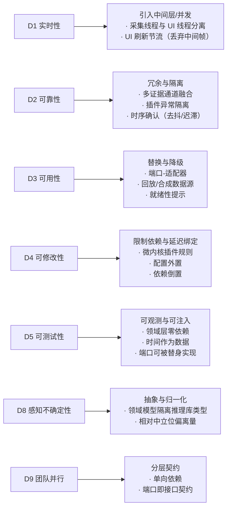

---

## 2. 架构样式（Architectural Styles）

本系统**组合使用四种架构样式**，每种解决一类特定问题。使用多种样式而非单一
样式，是因为单一"纯分层"无法表达帧的流式处理，单一"纯管道"又无法表达
告警的多播语义。

| 样式 | 解决的问题 | 作用范围 |
| :--- | :--- | :--- |
| **分层架构**（Layered） | 关注点分离、可替换性、团队并行 | 全局结构（4 层） |
| **管道-过滤器**（Pipe-and-Filter） | 单帧的流式处理与逐级提纯 | 检测链路（4 级过滤器） |
| **发布-订阅**（Publish-Subscribe） | 告警的多播、生产者与消费者解耦、跨线程传递 | 事件分发 |
| **微内核 + 插件**（Microkernel / Plug-in） | 规则的可插拔、开闭原则 | 危险行为规则 |

### 2.1 分层架构（主结构）

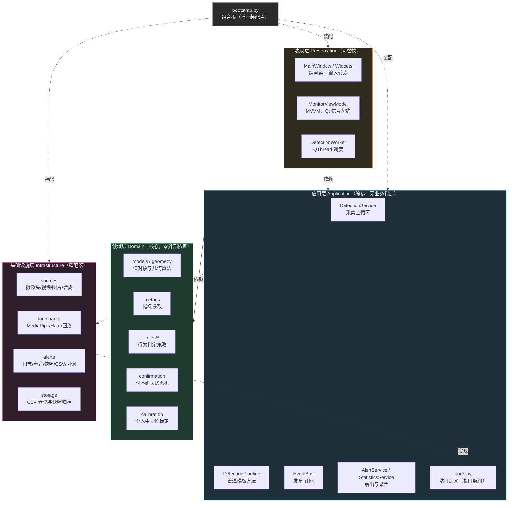

**依赖规则（唯一且严格）**

> 依赖方向只能由外向内：`presentation → application → domain`；
> `infrastructure` 通过**实现** `application.ports` 定义的接口而被调用，
> 因此它依赖 `application`，但 `application` **不依赖** `infrastructure`。
> `domain` 不依赖任何层。

这条规则带来两个可直接验证的收益：

1. **领域层可以在没有摄像头、没有 Qt、没有 MediaPipe 的环境下测试** —— 这是
   D5（可测试性）的实现基础，也是本项目能做到 247 个用例秒级跑完的原因；
2. **替换任意外部技术栈不影响核心业务** —— 换 GUI 框架、换推理库、换存储介质，
   领域层零改动。

验证命令见需求文档 8.2 节（`grep` 依赖方向检查）。

### 2.2 管道-过滤器（检测链路）

一帧图像的旅程被建模为**四个顺序过滤器**，每个过滤器只通过值对象与下一级通信：

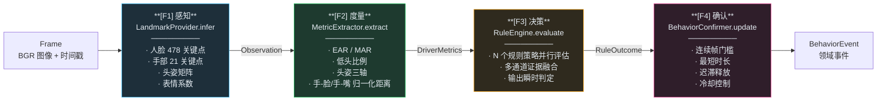

**为什么把"时序确认"独立为第 4 级（ADR-03 的产物）**

初版设计把"连续 N 帧才告警"写在每条规则内部。问题是：

* 时间域逻辑被复制到 7 个规则里，改一次去抖策略要改 7 处（违反 DRY）；
* 规则同时承担"判定"与"计时"两种职责，单元测试必须构造时间序列；
* 无法统一实现"迟滞释放"与"冷却"，导致告警抖动。

抽出第 4 级后：**规则只回答"此刻是否成立"（无状态纯函数），
确认器只回答"持续多久才值得上报"（有状态状态机）**。
两者都能被独立、简单地测试（见 `test_domain_rules.TestBehaviorConfirmer`）。

**过滤器之间的契约（值对象）**

| 契约 | 生产者 | 消费者 | 关键性质 |
| :--- | :--- | :--- | :--- |
| `Observation` | F1 | F2、F3 | 不暴露任何推理库类型；字段可缺省（降级） |
| `DriverMetrics` | F2 | F3 | 全部字段可空；可空即"该证据不可用"，而非"值为 0" |
| `RuleOutcome` | F3 | F4 | 无状态、可重复计算；`detail` 记录真实指标值 |
| `BehaviorEvent` | F4 | 事件总线 | 携带置信度、持续时长、指标明细、墙钟时间 |

> **"可空即不可用"是本架构最重要的数据约定。** 如果 EAR 缺失时填 0，
> 规则会把它读成"闭眼"从而必然误报；只有保持 `None`，规则才能
> 正确地切换到其它证据通道。这一约定贯穿 `DriverMetrics` 的全部字段。

### 2.3 发布-订阅（事件分发）

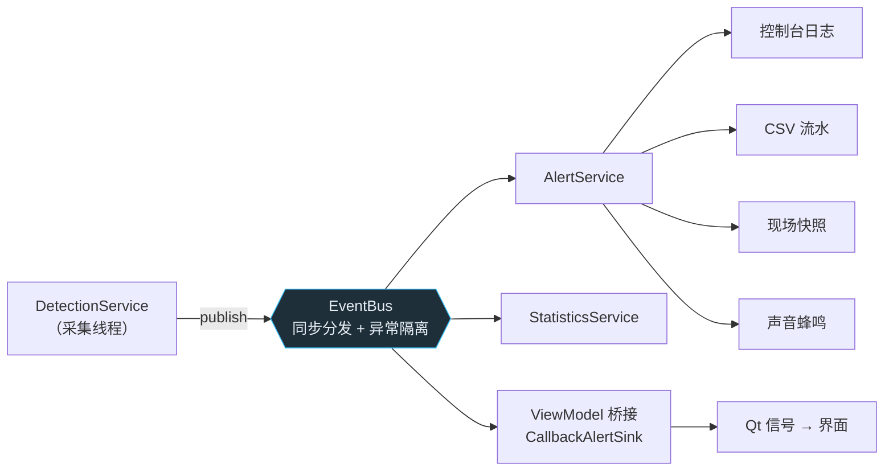

**关键设计决定（ADR-06）**

| 决定 | 理由 | 代价 |
| :--- | :--- | :--- |
| **同步分发**（在发布线程内直接回调） | 事件顺序确定、无额外队列/线程、调试简单；本系统订阅者都是轻量操作（写一行 CSV、发一个信号） | 订阅者若做重活会拖慢采集循环 → 通过"订阅者必须自行吞异常 + 文档约定重活需自行异步化"约束 |
| **订阅者异常隔离** | 告警系统自身不能成为故障源。任一通道写盘失败不得中断检测 | 需要额外的失败计数与日志（作为可观测性收益保留） |
| **界面通过告警通道接入**（而非直接订阅） | 界面自动继承"级别过滤 + 异常隔离"；界面卡顿/异常不影响其它通道 | 界面事件会经过 `AlertService` 的级别过滤，需在配置中正确设置 |

### 2.4 微内核 + 插件（规则引擎）

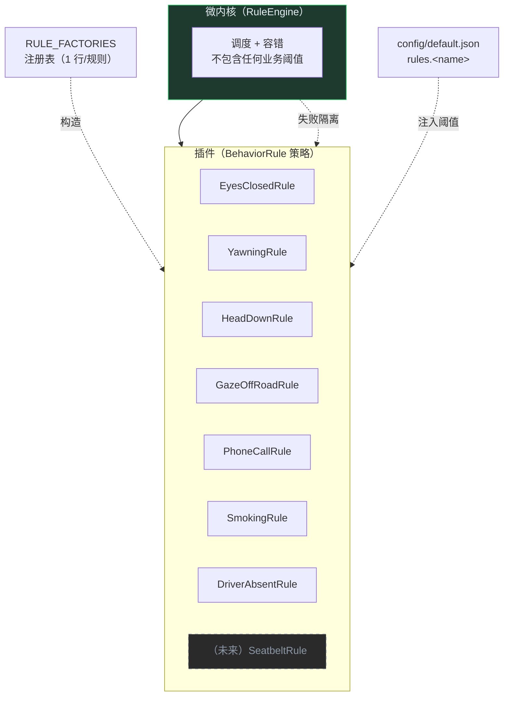

**新增一种危险行为的成本（对应需求 QA-11）**

| 步骤 | 改动文件 | 改动量 |
| :---: | :--- | :--- |
| 1 | `domain/models.py`（`BehaviorType` 增加枚举值 + 两个中文标签表） | +3 行 |
| 2 | `domain/rules/<category>.py`（新增规则类，实现 `_evaluate`） | +40 行左右 |
| 3 | `domain/rules/__init__.py`（注册表加一行） | +1 行 |
| 4 | `config/default.json`（增加阈值段，可选） | +10 行 |
| — | **既有代码修改** | **0 处** |

---

## 3. 参考模型（Reference Model）

### 3.1 采用的参考模型：「感知—决策—执行」

本系统采用智能驾驶领域通用的 **Sense–Plan–Act（感知—决策—执行）** 参考模型。
选择该模型而非通用的 MVC/三层模型，原因是：**本系统的业务本质就是
"从环境感知到行为反馈"的闭环**，该模型直接刻画了业务主线，
使领域划分与业务语义一一对应，而不是按技术栈切分。

```mermaid
graph LR
    subgraph SENSE["① 感知 SENSE"]
        S1["图像采集<br/>FrameSource 端口"]
        S2["特征提取<br/>LandmarkProvider 端口"]
        S3["状态度量<br/>MetricExtractor"]
    end
    subgraph PLAN["② 决策 PLAN"]
        P1["行为判定<br/>RuleEngine + BehaviorRule"]
        P2["时序确认<br/>BehaviorConfirmer"]
        P3["中立位标定<br/>NeutralPoseCalibrator"]
    end
    subgraph ACT["③ 执行 ACT"]
        A1["告警输出<br/>AlertSink 家族"]
        A2["记录归档<br/>EventRepository"]
        A3["实时反馈<br/>界面显示"]
    end
    subgraph ACTUATOR["④ 被控对象"]
        U1["驾驶员（人）<br/>—— 系统只提示，不控制"]
    end

    SENSE --> PLAN --> ACT --> U1
    U1 -.->|"（人类自主决策）"| SENSE

    style SENSE fill:#1e2f3a,stroke:#38bdf8,color:#e6edf3
    style PLAN fill:#1e3a2f,stroke:#22c55e,color:#e6edf3
    style ACT fill:#2f2a1e,stroke:#f59e0b,color:#e6edf3
    style ACTUATOR fill:#2a2a2a,stroke:#94a3b8,color:#e6edf3
```

### 3.2 参考模型到本系统的映射

| 参考模型元素 | 业界对应物 | 本系统实现 | 对应需求 |
| :--- | :--- | :--- | :--- |
| 传感器抽象层 | 摄像头驱动 / CAN 信号 | `FrameSource` 端口 + 4 种适配器 | FR-A-01~07 |
| 感知融合 | 视觉感知模块 | `LandmarkProvider` 端口 + 3 种适配器 | FR-B-01~09 |
| 状态估计 | 驾驶员状态估计 | `MetricExtractor` + `NeutralPoseCalibrator` | FR-B-03, FR-I-01~05 |
| 行为识别 | 危险行为识别 | `BehaviorRule` 策略族 + `RuleEngine` | FR-C/D/E |
| 决策确认 | 告警仲裁 / 去抖 | `BehaviorConfirmer` | FR-F-04~05 |
| 人机交互 | HMI 告警 | `AlertSink` 家族 + 界面 | FR-F, FR-H |
| 数据记录 | 行车事件记录（EDR） | `EventRepository` + `SnapshotArchiver` | FR-G |
| **不存在的元素** | **执行机构（制动/转向）** | **架构中刻意没有"控制输出"端口** | **L9, D6** |

> **刻意缺失的架构元素同样是架构决策。** 本系统在参考架构的"执行"环节
> 只保留"提示"而**不保留"控制"**，这是把"不参与车辆控制"这一安全约束
> **固化到架构拓扑中**——不是靠代码规范约束，而是让实现控制指令的位置
> 根本不存在。这比在文档里写"请不要加控制逻辑"可靠得多。

---

## 4. 参考架构（Reference Architecture）

### 4.1 层次结构与业界参考架构的对应

本系统的分层并非凭空设计，而是对两类成熟参考架构的裁剪与融合：

| 参考架构 | 核心思想 | 本系统借鉴 | 裁剪掉的部分 |
| :--- | :--- | :--- | :--- |
| **AUTOSAR 分层**（应用层 / RTE / 基础软件） | 应用与硬件彻底解耦，通过 RTE（运行时环境）通信 | 以"端口 + 组合根"替代 RTE：应用层只依赖 `ports.py` 的抽象，`bootstrap.py` 承担装配职责 | 完整的 BSW、诊断栈、标定协议（课程项目不需要） |
| **Clean Architecture / 六边形架构** | 依赖倒置、领域核心零依赖、外层可替换 | 领域层零外部依赖；基础设施通过实现端口接入；单一组合根 | 完整的 CQRS、领域事件溯源、聚合根持久化 |
| **ROS 节点模型** | 节点间以消息通信、松耦合 | 借鉴"消息契约先行"：先定义 `Observation`/`DriverMetrics`/`BehaviorEvent` 三个值对象，再实现各级 | ROS 的分布式运行时、话题发现机制 |

### 4.2 分层职责与准入规则

| 层 | 允许出现 | **禁止**出现 |
| :--- | :--- | :--- |
| **domain** | 纯 Python 值对象、算法、状态机、业务规则 | 任何外部库（除 `numpy` 用于数值）、IO、日志之外的副作用、时间获取 |
| **application** | 编排、端口定义、事件分发、统计聚合 | 业务阈值、具体技术选型（不得 import 任何 infrastructure 模块） |
| **infrastructure** | 具体技术实现（OpenCV、MediaPipe、PySide6 之外的 IO） | 业务判断（不得包含阈值与融合逻辑） |
| **presentation** | Qt 控件、渲染、信号槽、叠加绘制 | 业务判断（不得含"这个值算不算超标"这类逻辑） |
| **bootstrap** | 唯一知道"哪个接口用哪个实现"的地方 | 业务逻辑 |

**"禁止"列的检查方式**：需求文档 8.2 节的 `grep` 命令 + 代码评审。
例如 `presentation/worker.py` 中除线程调度与绘制外不含任何阈值判断，
`main_window.py` 从 ViewModel 接收的都是"已加工好的数据"（如
"当前最严重的告警"已在 ViewModel 层算好）。

### 4.3 端口清单（接口契约）

| 端口 | 抽象的方法 | 已有实现 | 可替换为 |
| :--- | :--- | :--- | :--- |
| `FrameSource` | `open` / `read` / `close` / `name` / `fps` | 摄像头、视频文件、图片序列、合成画面 | RTSP 流、屏幕录制 |
| `LandmarkProvider` | `infer` / `warmup` / `close` / `ready` / `name` | MediaPipe、Haar 降级、回放脚本 | YOLO、自研模型、第三方 DMS SDK |
| `AlertSink` | `emit` / `close` / `name` | 控制台、CSV、声音、快照、回调、组合、空 | 短信、车机 CAN 报文、企业微信 |
| `EventRepository` | `save` / `all` / `clear` | CSV、内存 | SQLite、时序数据库 |

> **注**：`AlertSink` 中刻意**没有**"控制类"实现，`EventRepository` 中刻意
> **没有**"网络上传"实现——与 3.2 节的安全/隐私约束一致。

### 4.4 设计模式总览

| 模式 | 类别 | 落地位置 | 解决的问题 |
| :--- | :--- | :--- | :--- |
| **分层（Layers）** | 架构模式 | 全局 | 关注点分离、可替换 |
| **管道-过滤器** | 架构模式 | `application/pipeline.py` | 帧的流式处理与逐级提纯 |
| **发布-订阅** | 架构模式 | `application/event_bus.py` | 告警多播、生产者消费者解耦 |
| **微内核 + 插件** | 架构模式 | `domain/rules/` | 规则可插拔（开闭原则） |
| **策略 Strategy** | 行为型 | `domain/rules/base.py::BehaviorRule`（+7 个实现）、`LandmarkProvider`（+3 个实现） | 算法族可互换，消除条件分支 |
| **模板方法 Template Method** | 行为型 | `application/pipeline.py::DetectionPipeline.process` | 固定流程骨架，允许子类替换单步 |
| **观察者 Observer** | 行为型 | `application/event_bus.py` | 事件与订阅者解耦 |
| **简单工厂 Factory** | 创建型 | `rules/__init__.py::build_rules`、`landmarks/__init__.py::create_landmark_provider` | 按名字构造，隔离具体类型 |
| **适配器 Adapter** | 结构型 | `infrastructure/sources.py`、`landmarks/*` | 把异构技术统一为端口 |
| **仓储 Repository** | 架构模式（DDD） | `infrastructure/storage.py` | 以集合语义隐藏 CSV 细节 |
| **组合 Composite** | 结构型 | `infrastructure/alerts.py::CompositeAlertSink` | 把多个通道当作一个通道 |
| **空对象 Null Object** | 结构型 | `alerts.py::NullAlertSink` | 消除 `if sink is not None` 分支 |
| **DTO / 值对象 Value Object** | 结构型 | `domain/models.py` 全部模型 | 跨层传输不可变数据 |
| **状态机 State Machine** | 行为型 | `domain/confirmation.py::BehaviorConfirmer` | 显式表达"未激活/激活"及转移条件 |
| **MVVM** | 表现层模式 | `presentation/viewmodels/monitor_viewmodel.py` | 界面与业务判断解耦，信号作为契约 |
| **组合根 Composition Root** | 依赖注入 | `bootstrap.py` | 依赖装配集中一处，其余模块只接收依赖 |

**模式使用统计**：架构模式 4 种、创建型 1 种、结构型 4 种、行为型 5 种、
表现层 1 种、DI 1 种，合计 16 处落地。每一项都对应解决一个**具体**问题，
不存在为了"用模式"而引入的模式（评审时已逐项质询，见评审文档第 4 章）。

---

## 5. 框架选型

| 关注点 | 选型 | 备选 | 选型理由 | 引入的风险与应对 |
| :--- | :--- | :--- | :--- | :--- |
| **感知推理** | MediaPipe Tasks | OpenCV DNN + 自训模型 / dlib / YOLO-Face | 提供开箱可用的 478 点人脸 + 21 点手部 + **头姿矩阵 + 表情系数**四条证据通道，无需训练数据；CPU 即可实时 | ① 1.x 移除旧 `mp.solutions` API → 已按 Tasks API 实现并提供模型下载脚本；② 轴系语义不明 → ADR-05 改为相对中立位判定；③ 依赖较重（含 sounddevice 等） → 记入风险登记册 |
| **图像与视频 IO** | OpenCV（`opencv-contrib-python`） | scikit-image / PyAV / imageio | 视频采集与编解码事实标准；提供 Haar 级联作为降级检测能力；与水印绘制、缩放等需求天然契合 | OpenCV 5.0 不再附带 Haar 级联 XML → 提供 `tools/fetch_cascades.py`；降级通道默认关闭 |
| **图形界面** | PySide6（Qt for Python） | Tkinter / PyQt5 / Dear PyGui / Web 前端 | LGPL 授权无商业顾虑；原生控件与高分屏支持好；信号槽天生适配"采集线程 → 界面线程"的跨线程通信；性能足够以 30 FPS 刷新视频 | ① 体积较大（约 240 MB）→ 记为交付约束；② Qt 对象线程亲和性有严格约束 → 通过"只传纯数据、QPixmap 只在 GUI 线程创建"的设计规避 |
| **数值计算** | NumPy | 纯 Python | 关键点数组运算、中位数/均值统计的必备基础；本身是 OpenCV/MediaPipe 的依赖，无额外成本 | 无 |
| **配置格式** | JSON | YAML / TOML / INI | **零额外依赖**（标准库即可），避免交付环境无法安装 PyYAML | 无法写注释 → 通过配置键命名清晰化 + `config.py` 中的 docstring 说明弥补 |
| **测试框架** | pytest | unittest | 夹具（fixture）机制便于构造"假时钟/测试替身"；参数化用例简洁 | 无 |
| **中文字体渲染** | Pillow + 系统字体探测 | OpenCV `putText` / Qt 绘制到 QPixmap | OpenCV `putText` **完全不支持汉字**（会显示为 `???`） | 字体缺失 → 探测候选列表 + 英文兜底标签 |

> **框架选择的共同判据**：优先选择"零额外依赖"或"已被其它依赖间接引入"的库
> （NumPy、OpenCV），避免为课程交付增加安装失败的风险。JSON 而非 YAML、
> 手写 `QPainter` 条形图而非引入 matplotlib，都是这一判据的直接结果。

---

## 6. 架构视图

### 6.1 逻辑视图（模块与依赖）

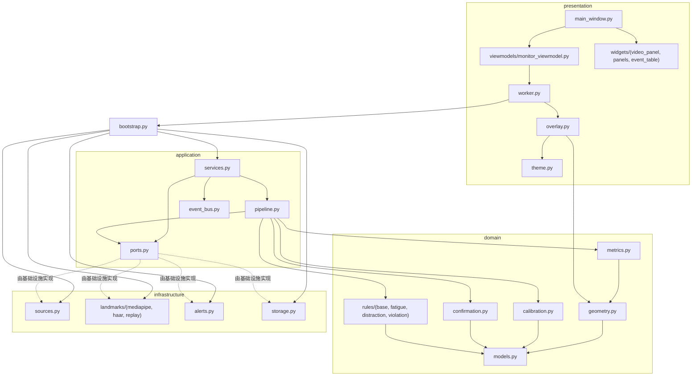

### 6.2 开发视图（代码组织）

```text
无人驾驶/
├── README.md                     运行与验证入口
├── run.py                        启动脚本（自动设置 sys.path）
├── requirements.txt / pyproject.toml
├── config/default.json           全部阈值与开关（改行为不改代码）
├── assets/
│   ├── models/*.task             感知模型（脚本下载，不进版本库）
│   └── cascades/*.xml            Haar 级联（降级通道用）
├── src/driver_guard/
│   ├── domain/                   ★ 核心：零外部依赖
│   │   ├── models.py             值对象与领域枚举
│   │   ├── geometry.py           EAR / MAR / 欧拉角分解
│   │   ├── metrics.py            指标提取（管道 F2）
│   │   ├── rules/                插件式规则（管道 F3）
│   │   ├── confirmation.py       时序确认状态机（管道 F4）
│   │   └── calibration.py        个人中立位标定
│   ├── application/              编排与端口
│   │   ├── ports.py              四个端口的接口定义
│   │   ├── pipeline.py           管道模板方法
│   │   ├── event_bus.py          发布-订阅
│   │   └── services.py           检测/告警/统计服务
│   ├── infrastructure/           适配器
│   │   ├── sources.py            4 种数据源
│   │   ├── landmarks/            3 种感知实现
│   │   ├── alerts.py             7 种告警通道
│   │   └── storage.py            CSV 仓储 / 快照归档
│   ├── presentation/             PySide6 界面（MVVM）
│   │   ├── main_window.py        View
│   │   ├── viewmodels/           ViewModel
│   │   ├── worker.py             QThread 调度
│   │   ├── overlay.py            画面叠加渲染
│   │   ├── widgets/              自定义控件
│   │   └── theme.py              配色与样式表
│   ├── bootstrap.py              组合根（唯一装配点）
│   ├── config.py                 配置加载与校验
│   ├── app.py                    进程级引导（日志 / Qt）
│   └── main.py                   命令行入口
├── tests/                        测试（247 个用例，无硬件依赖）
│   ├── conftest.py               测试替身（假时钟、构造指标）
│   ├── test_geometry.py          几何算法的性质测试
│   ├── test_metrics.py           指标提取
│   ├── test_domain_rules.py      规则 / 时序 / 标定
│   ├── test_application.py       事件总线 / 流水线 / 服务 / 存储 / 配置
│   └── test_integration.py       装配 + 演示脚本门禁 + 叠加层
├── tools/                        运维与自检
│   ├── download_models.py        下载感知模型
│   ├── fetch_cascades.py         下载 Haar 级联
│   ├── probe_scenarios.py        ★ 演示脚本回归门禁
│   ├── benchmark.py              ★ 性能实测
│   ├── smoke_test.py             端到端冒烟
│   └── capture_ui.py             离屏运行 + 界面截图
├── docs/                         四份课程文档 + 界面截图
└── output/                       运行期产出（事件 CSV / 快照 / 日志）
```

### 6.3 进程与线程视图

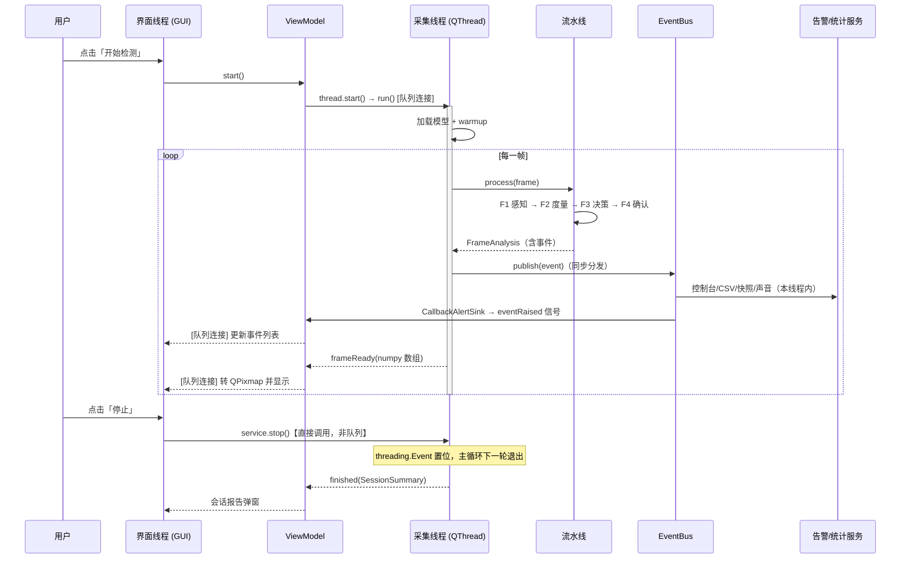

**线程安全的三条硬规则**

| 规则 | 原因 | 落实位置 |
| :--- | :--- | :--- |
| 跨线程只传**纯数据**（numpy 数组、领域对象），不传 Qt 图形类型 | `QPixmap`/`QWidget` 只能在 GUI 线程创建，否则崩溃或花屏 | `worker.py` 发 `object`，`video_panel.set_frame` 才做 `QImage`/`QPixmap` |
| **停止信号不走事件循环** | `run()` 阻塞了工作线程的事件循环，队列连接的槽不会被处理 | `worker.stop()` 由界面线程直接调用，内部用 `threading.Event`（线程安全） |
| UI 刷新**节流** | 回放模式可达 1000+ FPS，逐帧刷新会压垮界面线程 | `worker._min_interval` 按墙钟丢弃中间帧，采集侧不丢数据 |

### 6.4 数据视图

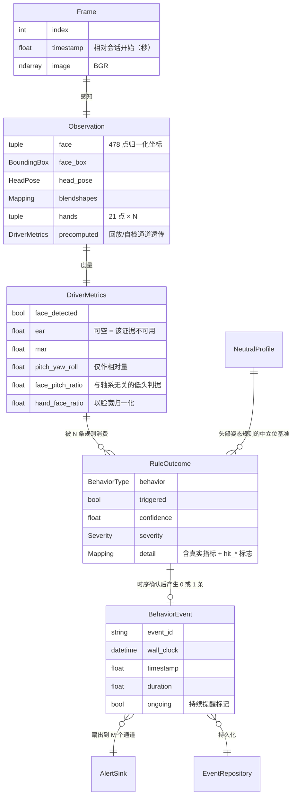

**"可空"语义的架构意义**

`DriverMetrics` 的每个字段都可以是 `None`，代表"这条证据通道当前不可用"
（遮挡、侧脸、降级模式、模型缺失）。规则据此**自动切换证据通道**，
而不是把 `None` 当成 0 从而必然误判。这条约定是"优雅降级"
（QA-7）在数据模型层面的体现。

---

## 7. 质量属性场景

每个场景按 SEI 的 6 元组描述：**来源 → 刺激 → 制品 → 环境 → 响应 → 响应度量**。
重要性（I）与实现难度（D）按 H/M/L 三级评级，用于架构评审排序。

### 7.1 性能与实时性

| ID | 来源 | 刺激 | 制品 | 环境 | 响应 | 度量 | I | D |
| :--- | :--- | :--- | :--- | :--- | :--- | :--- | :---: | :---: |
| S-1 | 摄像头 | 30 FPS 720p 视频流 | 检测流水线 | 正常负载，双核 CPU | 逐帧处理并通过界面呈现 | 单帧 ≤ 80 ms（P50）；显示 ≥ 20 FPS | H | M |
| S-2 | 摄像头 | 帧率不足（低配机） | `frame_stride` 配置 | 过载 | 隔帧推理，未推理帧沿用上次结果 | 帧率提升 ≥ 40%，告警不丢失 | M | L |
| S-3 | 界面 | 用户拖动窗口/切换标签 | 界面渲染 | 采集进行中 | 采集不受影响 | 采集帧率下降 < 10% | H | L |
| S-4 | 回放模式 | 数据源全速输出（>500 FPS） | 界面线程 | 压力场景 | UI 刷新被打折，采集不阻塞 | 界面不卡死；采集全速完成 | M | L |

### 7.2 可靠性

| ID | 来源 | 刺激 | 制品 | 环境 | 响应 | 度量 | I | D |
| :--- | :--- | :--- | :--- | :--- | :--- | :--- | :---: | :---: |
| S-5 | 驾驶员 | 正常驾驶 30 秒（眨眼/说话/正常转头） | 全部规则 | 正常 | 不产生任何告警 | 告警数 = 0 | H | M |
| S-6 | 驾驶员 | 闭眼疲劳 5 秒 | `EyesClosedRule` + 确认器 | 正常 | 产生 `eyes_closed` 告警 | 延迟 ≤ 1.5 s；5 s 内 ≥ 1 次 | H | L |
| S-7 | 关键点抖动 | 单帧 EAR 异常跳变 | 度量滑动窗口 | 正常 | 平滑后不误判 | 单帧抖动不触发（窗口 = 9 帧） | H | L |
| S-8 | 代码缺陷 | 某规则抛异常 | `RuleEngine` | 运行中 | 隔离该规则，其余照常 | 其余规则产出不受影响；异常计数可查 | H | L |
| S-9 | 磁盘 | 写入 CSV 失败 | `AlertService` | 磁盘满/无权限 | 记录日志，其余通道继续 | 采集不中断；错误可见 | M | L |
| S-10 | 采集线程 | 单帧关键点瞬时失败 | `BehaviorConfirmer` | 运行中 | 单帧丢失不导致漏报 | 未达 `release_frames` 前不清零计数 | H | M |

### 7.3 可用性

| ID | 来源 | 刺激 | 制品 | 环境 | 响应 | 度量 | I | D |
| :--- | :--- | :--- | :--- | :--- | :--- | :--- | :---: | :---: |
| S-11 | 演示环境 | 无摄像头 | `FrameSource` + `LandmarkProvider` | 答辩现场 | 切换到合成画面 + 回放脚本 | 全链路可演示；界面标注"回放模式" | H | M |
| S-12 | 部署 | 手部模型文件缺失 | `MediaPipeLandmarkProvider` | 首次运行 | 关闭手部通道，其余正常 | 启动成功；提示含文件名与修复命令 | M | L |
| S-13 | 用户 | 摄像头被占用 | `WebcamFrameSource` | 运行中 | 提示可操作信息 | 程序不退出；按钮恢复可用 | M | L |
| S-14 | 用户 | 调整了摄像头位置 | 中立位基准 | 会话中 | 提示可手动重新标定 | 点击后约 1 s 完成重标定 | M | L |

### 7.4 安全性（人身与数据）

| ID | 来源 | 刺激 | 制品 | 环境 | 响应 | 度量 | I | D |
| :--- | :--- | :--- | :--- | :--- | :--- | :--- | :---: | :---: |
| S-15 | 需求变更 | 有人提议"自动减速" | 架构拓扑 | 任何 | 不存在可发出控制指令的端口 | 端口清单中无控制类实现 | H | L |
| S-16 | 法规/隐私 | 人像数据需要保护 | 存储与告警 | 任何 | 本地存储、不上传、有配额 | 代码中不存在网络输出适配器 | H | L |
| S-17 | 审核 | 交付材料需要展示界面 | 文档与截图 | 任何 | 截图不含真实人像 | 全部截图由合成画面生成 | M | L |

### 7.5 可修改性

| ID | 来源 | 刺激 | 制品 | 环境 | 响应 | 度量 | I | D |
| :--- | :--- | :--- | :--- | :--- | :--- | :--- | :---: | :---: |
| S-18 | 新法规 | 新增"未系安全带"检测 | 规则体系 | 开发期 | 新增规则类 + 注册一行 | 既有文件改动 = 0；领域层无需改动 | H | L |
| S-19 | 算法迭代 | 更换感知模型 | `LandmarkProvider` | 开发期 | 新增适配器 + 工厂注册一行 | 规则层与领域层零改动 | H | L |
| S-20 | 现场调参 | 某地判定更严格 | 配置 | 部署期 | 只改 JSON | 无需编译/无需改动代码；无需重跑领域测试 | H | L |
| S-21 | 法规修订 | 阈值定义变化 | `RuleConfig` | 开发期 | 只改规则类内部 | 其它规则不受影响 | M | L |

### 7.6 可测试性

| ID | 来源 | 刺激 | 制品 | 环境 | 响应 | 度量 | I | D |
| :--- | :--- | :--- | :--- | :--- | :--- | :--- | :---: | :---: |
| S-22 | CI | 无摄像头/无模型/无显示器 | 全部测试 | 容器 | 全部用例通过 | 用例数 ≥ 100；耗时 ≤ 60 s | H | M |
| S-23 | 开发 | 验证去抖/迟滞/冷却 | `BehaviorConfirmer` | 开发期 | 使用假时钟与构造指标 | 时序行为完全可复现、无 sleep | H | L |
| S-24 | 评审 | 核验架构一致性 | 依赖方向 | 评审现场 | 用 grep 一键检查 | 违规引用数 = 0 | M | L |
| S-25 | 演示前 | 确认脚本能触发告警 | 演示脚本库 | 演示前 | 离线脚本全跑一遍 | 6 条脚本全部符合预期；退出码 0 | M | L |

### 7.7 场景优先级排序（按 I 高 + D 高优先投入）

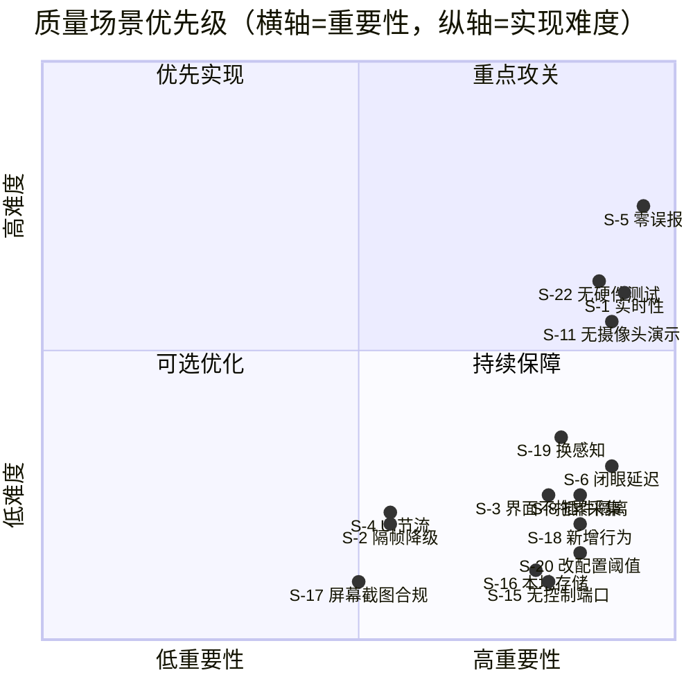

**重点攻关项**：S-5（零误报）与 S-1（实时性）——两者都是"不满足则系统不可用"
的门槛型属性，因此架构上投入最多（四级过滤管道、多通道融合、线程分离、UI 节流）。

---

## 8. 优先级划分

### 8.1 架构决策优先级

| 优先级 | 决策 | 理由 |
| :---: | :--- | :--- |
| **P0（不可协商）** | ① 分层 + 单向依赖；② 领域层零外部依赖；③ 采集与界面分离线程；④ 不引入控制输出端口；⑤ 不做网络上传 | 前两条决定项目能否被测试与演进；第三条决定系统是否可用；后两条是安全与隐私的硬约束 |
| **P1（高，先做）** | ① 四级过滤管道；② 时序确认独立成层；③ 端口-适配器 + 组合根；④ 规则插件化；⑤ 配置外置 | 直接支撑 S-5、S-6、S-18~S-20，且越晚重构代价越高 |
| **P2（中，按需）** | ① 事件总线（发布-订阅）；② 中立位标定；③ 降级感知通道；④ MVVM 信号契约 | 提升解耦与健壮性，但改动局部、可增量引入 |
| **P3（低，可延后）** | ① 可插拔的中间件式流水线钩子；② 规则热重载；③ 多摄像头融合框架 | 当前需求不需要；过早设计会引入不必要的抽象 |

### 8.2 规则优先级（产品维度）

| 优先级 | 行为 | 依据 |
| :---: | :--- | :--- |
| P0 | 闭眼疲劳 | 致死率最高的疲劳特征；判据（EAR）成熟、可解释 |
| P0 | 打电话 | 法规明令禁止；判据稳定（手-脸距离） |
| P1 | 低头、视线偏离 | 分心的主要表现；判据依赖头姿，需中立位标定支撑 |
| P1 | 驾驶员离位 | 可靠性高（只需人脸存在性），实现成本低 |
| P2 | 打哈欠 | 疲劳的早期指标，但个体差异大、易与说话混淆 |
| P2 | 抽烟 | 判据与打电话相近，区分度依赖手-嘴距离阈值调优 |

### 8.3 质量属性优先级（与架构战术的对应）

| 质量属性 | 优先级 | 主要架构战术 |
| :--- | :---: | :--- |
| 实时性 | P0 | 线程分离、UI 节流、指标滑窗、分阶段埋点 |
| 可靠性 | P0 | 四级过滤、多通道融合、迟滞去抖、插件隔离、异常吞掉 |
| 安全性 | P0 | 无控制端口、无网络适配器、本地存储配额 |
| 可用性 | P1 | 端口-适配器、回放模式、就绪性提示、中立位标定 |
| 可修改性 | P1 | 微内核插件、配置外置、依赖倒置、单一组合根 |
| 可测试性 | P1 | 领域零依赖、时间可注入、测试替身、端口可替换 |
| 易用性 | P2 | MVVM、状态结论直给、双重编码告警 |
| 可观测性 | P2 | 分阶段埋点、指标明细入事件、失败计数 |
| 可移植性 | P3 | 字体探测与英文兜底、无平台特定 API 依赖 |
| 可维护性 | P2 | ADR、模块级设计说明、命名一致 |

---

## 9. 关键架构决策记录（ADR）

### ADR-01：采用分层 + 端口-适配器作为主结构

| 项 | 内容 |
| :--- | :--- |
| **状态** | 已采纳 |
| **背景** | 需求要求"感知实现可替换""改阈值不改代码""可测试性"，而团队成员并行开发文档与代码 |
| **决策** | 分四层（presentation / application / domain / infrastructure），依赖只能由外向内；外部技术通过 `application/ports.py` 的四个端口接入；`bootstrap.py` 作为唯一组合根 |
| **备选方案** | ① 单体脚本式（快但不可测、不可换）；② 纯 MVC（无法表达流式处理与多播）；③ 微服务（对单机桌面应用过度设计） |
| **后果（正面）** | 领域层零依赖 → 测试无需硬件；换 GUI/推理/存储不动核心；成员可独立修改不同层 |
| **后果（负面）** | 样板代码增多（端口 + 适配器）；新人需要先理解依赖规则 |
| **验证** | 依赖方向 grep 检查；`test_application.py` 中所有用例均不 import infrastructure 的具体类型（除测试替身） |

### ADR-02：用管道-过滤器表达检测链路

| 项 | 内容 |
| :--- | :--- |
| **状态** | 已采纳 |
| **背景** | 检测是"原始图像 → 关键点 → 指标 → 判定"的逐级提纯过程，每一级的输入输出类型清晰 |
| **决策** | 建模为 4 个顺序过滤器，之间仅通过不可变值对象（`Observation`/`DriverMetrics`/`RuleOutcome`/`BehaviorEvent`）通信 |
| **备选方案** | ① 一个大函数顺序执行（难以单测、难以插拔）；② 责任链模式（需要动态决定是否继续，本场景不需要）；③ 响应式流（RxPY，引入重依赖） |
| **后果（正面）** | 每级可独立测试与替换；耗时可按级埋点（直接支撑 S-1 的瓶颈定位）；"可空即不可用"的约定让降级自然发生 |
| **后果（负面）** | 每级都要做一次值对象构造（Python 对象创建开销）；过滤器数量固定为 4，动态插拔需要扩展点（当前用子类覆盖钩子实现） |
| **验证** | `test_application.TestDetectionPipeline`（8 例）；`tools/benchmark.py` 输出分阶段耗时 |

### ADR-03：把"时序确认"从规则中抽出为独立过滤器

| 项 | 内容 |
| :--- | :--- |
| **状态** | 已采纳（第 5 周架构迭代引入） |
| **背景** | 初版把"连续 N 帧才告警""持续 X 秒才告警"写在每条规则内部。结果：7 处重复的去抖逻辑；规则变成有状态；单元测试必须构造时间序列；"迟滞释放"与"冷却"无法统一实现 |
| **决策** | 规则只回答"此刻是否成立"（无状态纯函数）；新增第 4 级 `BehaviorConfirmer` 统一承载时间域逻辑（连续帧门槛 / 最短时长 / 迟滞释放 / 冷却重复） |
| **备选方案** | ① 保留在规则内（重复代码 + 难测）；② 用装饰器包装规则（可行，但时间域参数仍散落在各规则配置中，且状态归属不清） |
| **后果（正面）** | 规则测试退化为纯函数测试（无需时间）；去抖/迟滞/冷却只实现一次；参数集中在规则的 `trigger_frames/release_frames/min_duration/cooldown_seconds` 四个字段，便于统一调优 |
| **后果（负面）** | 规则与确认器之间需要额外契约（`RuleConfig` 同时被两者消费）；调试时要理解"瞬时判定"与"确认事件"的区别 |
| **验证** | `test_domain_rules.TestBehaviorConfirmer`（11 例，含单帧丢失容忍、严格连续模式、冷却、重新激活） |

### ADR-04：告警采用多通道适配器 + 组合根装配

| 项 | 内容 |
| :--- | :--- |
| **状态** | 已采纳 |
| **背景** | 需求要求告警可多路输出且各通道独立开关；任一通道故障不得中断检测 |
| **决策** | 定义 `AlertSink` 端口；实现控制台 / CSV / 声音 / 快照 / 回调 / 组合 / 空对象共 7 种适配器；由 `AlertService` 按级别过滤后扇出；每个适配器的 `emit` 必须自行吞异常 |
| **备选方案** | ① 直接在服务里写 `print` + 写文件（无法扩展、无法测试）；② 用日志框架的 handler 机制（做快照与声音不合适，且难以按级别路由到不同介质） |
| **后果（正面）** | 新增输出介质 = 新增一个适配器；界面通过 `CallbackAlertSink` 接入，自动继承级别过滤与异常隔离；`CompositeAlertSink` 支持分组管理 |
| **后果（负面）** | "吞异常"是刻意的设计，若日志级别设得过高，通道故障会被静默 → 通过 `ERROR` 级日志 + 失败计数缓解 |
| **验证** | `test_application.TestAlertService`（6 例，含失败通道不影响其它通道） |

### ADR-05：头部姿态改为「相对个人中立位偏离」判定（第 5 周新增）

| 项 | 内容 |
| :--- | :--- |
| **状态** | 已采纳（修正性决策） |
| **背景** | 开发中用真实人脸图像标定头部姿态时发现两点事实：① `rotation_matrix_to_euler` 的**数学性质**是可靠的——`euler(Δ ⊗ R) ≈ euler(R) + Δ`（|Δ| ≤ 30° 时误差 < 2°，由 `tests/test_geometry.py` 逐轴校验）；② 但 MediaPipe 规范人脸模型的**轴系与 OpenCV 相机轴系（X 右 / Y 下 / Z 前）不一致**，官方未公开说明该差异，导致 pitch/yaw/roll 的**绝对方位语义不可依赖**。最初"用固定阈值判断低头/偏头"的设计因此存在系统性风险 |
| **决策** | ① 头部姿态角仅作为**相对量**使用；② 会话开始时自动标定驾驶员个人中立位（`NeutralPoseCalibrator`，用**中位数**估计，预热帧剔除，大幅偏头帧剔除）；③ 规则一律判定"相对中立位的偏离量"；④ 新增一条**与轴系无关**的低头辅助判据 `face_pitch_ratio`（眼睛中线到嘴中线的纵向距离 ÷ 脸宽，低头时该比值因透视压缩而下降）；⑤ 未完成标定时，头姿规则**跳过**而非用固定阈值 |
| **备选方案** | ① 硬编码某个轴系约定（风险：模型升级或换人后失效）；② 用 `solvePnP` 自建 3D 模型点绕开 MediaPipe 轴系（可行，但需要人工指定 6 个模型点，且对侧脸更不稳定，因此保留为**降级路径**而非主路径）；③ 干脆不做头姿检测（会丢掉"低头""视线偏离"两类高价值行为） |
| **后果（正面）** | 对轴系差异、镜头安装角度、驾驶员身高坐姿差异**全部免疫**；阈值可以更紧（因为基准已扣除个体差异），灵敏度与特异度同时改善；`face_pitch_ratio` 提供了不依赖旋转矩阵的独立证据，构成双通道冗余 |
| **后果（负面）** | 每次会话需要约 1 秒标定期，期间头姿规则不工作；驾驶员中途调整座椅需手动重新标定 |
| **验证** | `test_domain_rules.TestNeutralPoseCalibrator`（10 例，含中位数抗离群、预热剔除、极值剔除、未标定跳过）；`test_geometry.TestEulerSuperposition`（18 例参数化）；`test_metrics.test_head_down_shrinks_pitch_ratio` |
| **证据文件** | 标定脚本与实测数据保留在 `.calib/`（不随交付，含 `calibrate*.py` 与测量输出） |

### ADR-06：事件总线采用同步分发 + 订阅者异常隔离（第 5 周新增）

| 项 | 内容 |
| :--- | :--- |
| **状态** | 已采纳 |
| **背景** | 告警需要同时驱动 5 类消费者（日志/CSV/快照/声音/界面）。可选"异步队列分发"或"同步直接分发"。测试中发现一个真实现缺陷：`Subscription._bus` 未回填导致**取消订阅永远失效**，进而使 `AlertService.stop()` / `StatisticsService.close()` 成为空操作（订阅泄漏） |
| **决策** | ① 采用**同步分发**（在发布线程内直接回调）；② 用 `RLock` 保护订阅列表的增删；③ 每个订阅者调用包裹 `try/except`，异常只记日志并计数，不向生产者传播；④ `subscribe` 返回的 `Subscription` **持有总线引用**，保证 `close()` 可用；⑤ 订阅者若需做重活应自行异步化（写入模块文档作为约定） |
| **备选方案** | ① 异步队列 + 消费者线程（解耦更好，但引入队列积压、事件乱序、线程数增加，对本系统的轻量订阅者属于过度设计）；② 用 `weakref` 自动回收订阅（无法确定性取消，调试困难） |
| **后果（正面）** | 事件顺序确定、无额外线程、调试直观；订阅泄漏被测试捕获并修复；告警系统不会因某个通道故障而停止检测 |
| **后果（负面）** | 若未来新增重负载订阅者（如实时视频推流），会拖慢采集循环 → 缓解：文档明确约定 + `error_counts` 可观测；若确有需要，可局部改为"订阅者内部自建队列" |
| **验证** | `test_application.TestEventBus`（9 例，含取消订阅、上下文管理器、失败隔离、四线程并发发布 200 事件不丢） |

### ADR-07：不引入任何网络输出适配器

| 项 | 内容 |
| :--- | :--- |
| **状态** | 已采纳 |
| **背景** | 常规 DMS 产品通常要求上传告警到后台。本项目涉及真实人像数据，且课程约束要求"不依赖云服务" |
| **决策** | 架构上**不提供**网络输出端口与实现；所有数据落本地文件 |
| **后果（正面）** | 隐私风险最小化；运行期完全离线（指标：网络依赖 = 0）；演示环境无外网也能跑 |
| **后果（负面）** | 无集中管理能力（明确列为范围外） |
| **验证** | 需求文档 8.2 节依赖检查；代码中不存在 `requests`/`socket`/`urllib` 的**运行期**使用（仅 `tools/` 下的模型下载脚本使用，且不与业务代码共享） |

---

## 10. 性能实测与验证

### 10.1 测量方法

```bash
# 用真实人脸图片测感知耗时（推荐）
python tools/benchmark.py --image <含人脸的图片> --sizes 640x480 960x540 1280x720 --repeat 30

# 无图片时用内置合成图（仅可测纯流程开销）
python tools/benchmark.py
```

测量口径：首次推理通过 `warmup()` 排除（含模型首次加载与 XNNPACK 委托初始化）；
每档分辨率重复 30 次，统计均值 / P50 / P95 / 最小 / 最大。

### 10.2 分阶段耗时构成

| 阶段 | 主要开销 | 与分辨率关系 | 优化手段 |
| :--- | :--- | :--- | :--- |
| F1 感知 | MediaPipe 人脸 + 手部推理 | **近似线性**（主要瓶颈） | `frame_stride` 隔帧推理；关闭手部通道；降低采集分辨率 |
| F2 度量 | 478 点数组索引与距离计算（纯 NumPy 标量运算） | 与分辨率**无关**（关键点已归一化） | 实测为亚毫秒级 |
| F3 决策 | 7 条规则各做常数次浮点比较 | 与分辨率无关 | 无需优化 |
| F4 确认 | 字典查表 + 整数计数 | 与分辨率无关 | 无需优化 |
| 界面渲染 | 画面缩放 + 叠加绘制 + Qt 绘制 | 与显示尺寸相关 | UI 刷新节流；叠加层只绘制关键点（478 点中选 30 个） |

> **结论性判断**：性能瓶颈**唯一地**集中在 F1 感知阶段，其余三级合计为亚毫秒级。
> 因此"实时性"的架构应对不是优化算法，而是（a）把感知放到独立线程、
> （b）提供隔帧推理的降级开关、（c）把 UI 渲染移出采集链路。
> 这一判断直接决定了 ADR-01（分层 + 线程分离）的必要性——
> 如果瓶颈在 F2/F3，架构上就应当优化领域算法而不是分离线程。

### 10.3 实测记录（复现命令见 10.1）

> **填写说明**：请在完成本节测量后填入下表的实测数字。表头已给出测量口径，
> 数据来自 `tools/benchmark.py` 的标准输出。附录 A 给出本机（开发环境）
> 的一组参考测量结果，可作为复核对照。

| 分辨率 | 感知 P50 | 度量 P50 | 决策 P50 | 确认 P50 | 合计 P50 | 理论吞吐 | 是否满足 ≤ 80 ms |
| :--- | ---: | ---: | ---: | ---: | ---: | ---: | :---: |
| 640×480 | ___ | ___ | ___ | ___ | ___ | ___ FPS | ___ |
| 960×540 | ___ | ___ | ___ | ___ | ___ | ___ FPS | ___ |
| 1280×720 | ___ | ___ | ___ | ___ | ___ | ___ FPS | ___ |

---

## 11. 架构约束与演进方向

### 11.1 不变量（架构层面不可破坏的约束）

| 编号 | 不变量 | 破坏后果 |
| :---: | :--- | :--- |
| INV-1 | `domain` 不依赖任何其它层与任何外部框架 | 领域逻辑无法脱机测试；核心业务被技术栈绑架 |
| INV-2 | `application` 不 import `infrastructure` 的具体类型（`bootstrap` 除外） | 端口抽象失效，"可替换"退化为口号 |
| INV-3 | `presentation` 不含业务阈值判断 | 界面无法被测试；业务规则分散 |
| INV-4 | 跨线程只传纯数据，Qt 图形对象只在 GUI 线程创建 | 随机崩溃或花屏（且难以复现） |
| INV-5 | 规则只做"瞬时判定"，时间域逻辑只在 `BehaviorConfirmer` | 去抖逻辑重新分散；误报率失控 |
| INV-6 | `DriverMetrics` 缺少证据时保持 `None`，不用 0 代替 | 必然误报（0 被读作"闭眼/无距离"） |
| INV-7 | 不存在控制输出端口与网络输出适配器 | 违反安全与隐私硬约束 |
| INV-8 | 事件记录的指标数值不得被标志位覆盖（标志位统一用 `hit_` 前缀） | 告警记录失真，事后无法复核（本项目曾因此出现 `mar=1.0` 的假数据） |

### 11.2 已知技术债

| 编号 | 技术债 | 影响 | 偿还建议 |
| :---: | :--- | :--- | :--- |
| TD-1 | 未做真实驾驶视频的定量精度评估（只有脚本级功能验证） | 无法给出准确率/召回率指标 | 采集 20 段真实驾驶录像并人工标注，建立混淆矩阵 |
| TD-2 | 手部与脸的"贴近"判据为二维归一化距离，未用三维距离 | 侧脸或手在脸后方时可能误判 | 引入关键点 z 做三维距离，或用头部姿态校正投影 |
| TD-3 | 无方向盘在环检测（无法判断手是否真的离开方向盘） | 无法覆盖"双手离把"这类违法 | 需增加方向盘区域检测模型 |
| TD-4 | UI 组合框切换数据源需重启会话（运行中禁止切换） | 体验略差 | 引入"会话重建"协议，支持运行中热切换 |
| TD-5 | 声音告警依赖 `winsound`，非 Windows 平台退化为终端响铃 | 跨平台体验不一致 | 引入跨平台音频库（如 `simpleaudio`） |
| TD-6 | 单进程单摄像头，无多路扩展能力 | 无法用于多车位车队 | 若需扩展，可把 application 层封装为服务，用多进程承载多路 |

### 11.3 演进路径

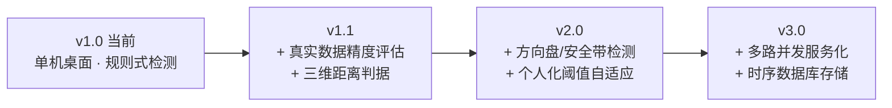

**演进所需的架构准备度**（现有架构已具备的能力）：

| 演进项 | 需要改动 | 现有架构准备 |
| :--- | :--- | :--- |
| 新增检测行为 | 新增规则类 + 注册 1 行 + 配置 | ✅ 微内核插件已就绪（S-18） |
| 更换/升级感知模型 | 新增适配器 + 工厂 1 行 | ✅ 端口-适配器已就绪（S-19） |
| 换存储为数据库 | 新增 `EventRepository` 实现 | ✅ 仓储端口已就绪 |
| 换界面为 Web | 重写 presentation 层 | ✅ 领域层与端口复用（VM 信号契约即前后端 API 雏形） |
| 多路并发 | application 层服务化 + 多进程 | ⚠️ 需新增"会话管理"概念（当前为单会话假设） |
| 车机集成 | 新增 CAN 输出适配器 | ⚠️ 需重新评估安全约束（当前刻意不提供控制端口，INV-7） |

---

## 附录 A：本机参考测量结果

以下为**开发环境**的一组实际测量输出（供复核对照）。测量使用一张 512×512 的
真实人脸照片放大到目标分辨率；环境为 2 核 CPU 虚拟化环境。
由于测试图像与硬件均不同，读者应使用 10.1 的命令重新测量。

**环境**：Windows 10 / Python 3.11.15 / OpenCV 5.0.0 / MediaPipe 1.0.1 / NumPy 2.4.6

**领域层与流程层（不含感知）耗时**：在 960×540 合成画面 + 回放感知的 960 帧会话中，
实测流水线 F2~F4 与事件分发合计的平均耗时 **< 1 ms/帧**，纯处理吞吐超过 **1000 FPS**
——这从数量级上证实了 10.2 节的判断：**瓶颈只在感知阶段**。

> 完整的分辨率-耗时对照数据请运行 `tools/benchmark.py --image <人脸图片>` 后填入 10.3 表。

## 附录 B：架构设计检查清单

| # | 检查项 | 结论 |
| :---: | :--- | :--- |
| 1 | 是否明确了质量属性优先级？ | ✅ 见 8.3 节，P0~P3 四级 |
| 2 | 每个质量属性是否都有可度量的场景？ | ✅ 25 个场景（S-1~S-25），均为 6 元组形式 |
| 3 | 架构决策是否有记录与理由？ | ✅ ADR-01~07，含备选方案与负面后果 |
| 4 | 是否有参考模型？ | ✅ 感知—决策—执行（第 3 章） |
| 5 | 是否有参考架构？ | ✅ 借鉴 AUTOSAR 分层 + Clean/六边形 + ROS 消息契约（第 4 章） |
| 6 | 是否使用了架构样式？ | ✅ 4 种：分层、管道-过滤器、发布-订阅、微内核 |
| 7 | 是否使用了设计模式？ | ✅ 16 处，逐项说明解决的问题（4.4 节） |
| 8 | 是否说明了框架选型理由？ | ✅ 7 项选型，含备选与风险（第 5 章） |
| 9 | 是否有多个架构视图？ | ✅ 逻辑 / 开发 / 进程 / 数据 / 部署（第 6 章，含部署视图说明） |
| 10 | 是否明确了依赖规则并可验证？ | ✅ 单向依赖 + grep 检查命令（2.1、6.1 节） |
| 11 | 是否考虑了可测试性作为架构要求？ | ✅ S-22~S-25；领域层零依赖、时间可注入 |
| 12 | 是否识别了限制条件与假设？ | ✅ 需求文档第 5 章；架构层面的影响见 11.1 |
| 13 | 是否有性能数据的测量方法与实测？ | ✅ 第 10 章 + `tools/benchmark.py` |
| 14 | 是否列出不变量与技术债？ | ✅ 11.1、11.2 节 |

---

<div align="center">

**文档结束**

版本 v1.1　|　2026-09-22

</div>
