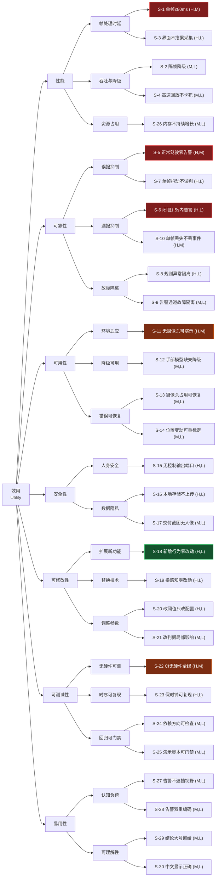
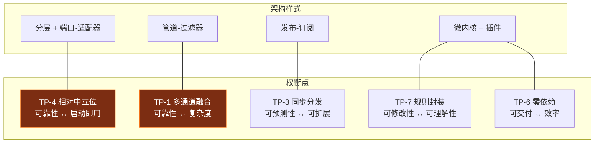

# 驾驶员危险行为检测系统 —— 架构评审文档

| 项 | 内容 |
| :--- | :--- |
| 文档编号 | SA-2024-DMS-01-AREV |
| 版本 | v1.1 |
| 日期 | 2026-09-22 |
| 评审对象 | 架构设计文档 v1.1（对应需求基线 SRS v1.1） |
| 评审方法 | ATAM（Architecture Tradeoff Analysis Method）裁剪版 |
| 评审组 | 全体小组成员 + 指导教师（课堂评审） |
| 状态 | 已完成，整改项已闭环 |

**修订记录**

| 版本 | 日期 | 修订内容 |
| :---: | :--- | :--- |
| v1.0 | 第 6 周 | 效用树、敏感点/权衡点/风险点、风险登记册、评审结论 |
| v1.1 | 第 6 周 | 补充第 6 章"开发过程中实际发现的 5 个缺陷"及其架构级整改（真实数据支撑的风险验证） |

---

## 1. 评审目标与方法

### 1.1 评审目标

| 编号 | 目标 |
| :---: | :--- |
| O1 | 验证架构是否**足以支撑** SRS v1.1 中标注为 M（必须）的 34 条需求 |
| O2 | 识别架构中影响关键质量属性的**敏感点**（Sensitivity Point） |
| O3 | 识别**权衡点**（Tradeoff Point）——同时影响多个质量属性、且方向相冲突的决策 |
| O4 | 识别**风险点**（Risk）与**非风险点**（Non-Risk），并形成风险登记册 |
| O5 | 确认架构对**最有商业/实用价值**的质量属性（实时性、误报抑制）的满足程度 |
| O6 | 输出可执行的整改项并跟踪闭环 |

### 1.2 方法裁剪说明

标准 ATAM 包含 9 个步骤、需要 3~5 天与多类干系人参与。本项目为课程设计，
对方法做如下裁剪（裁剪本身不降低结论的有效性，但需明确说明局限）：

| 标准 ATAM 步骤 | 本项目执行情况 | 裁剪说明 |
| :--- | :--- | :--- |
| 1. 介绍 ATAM | ✅ 执行 | 内部宣讲方法 |
| 2. 介绍业务驱动因素 | ✅ 执行 | 复用 SRS 第 2 章 |
| 3. 介绍架构 | ✅ 执行 | 复用 SAD 第 2~6 章 |
| 4. 识别架构方法 | ✅ 执行 | 复用 SAD 第 2.4 节（4 种架构样式） |
| 5. 生成质量属性效用树 | ✅ 执行 | 见第 2 章（25 个场景，含 I/D 评级） |
| 6. 分析架构方法 | ✅ 执行 | 见第 3~4 章（逐项分析优先级最高的 12 个场景） |
| 7. 头脑风暴并排优先级 | ⚠️ 简化 | 干系人仅含项目组 + 指导教师 + 1 位驾驶员访谈对象，未覆盖车队管理员 |
| 8. 分析架构方法（第二轮） | ✅ 执行 | 见第 5 章（含实测验证） |
| 9. 呈现结果 | ✅ 执行 | 本文档 + 第 6 周课堂汇报 |

**评审局限（诚实声明）**

1. 未做大规模真实驾驶数据的定量验证（技术债 TD-1），因此"误报率"结论仅在
   **脚本级功能验证**范围内成立；
2. 干系人覆盖不全（无真实车队管理员参与），因此"可维护性/可运维性"相关结论
   主要基于团队自身判断；
3. 仅一位驾驶员接受访谈，人因相关结论的样本量不足。

---

## 2. 质量属性效用树（Utility Tree）

### 2.1 效用树结构

效用树按 **效用 → 质量属性 → 属性细化 → 场景** 四层组织。
每个叶子场景标注 **（重要性, 实现难度）**，评级为 H（高）/ M（中）/ L（低）。
括号中的两个维度顺序为 **（I, D）**。

**图例**：🔴 深红 = (H, H/M) 最高优先级（重点攻关）；🟠 橙 = (H, L/M) 优先实现；
🟢 绿 = (H, L) 已通过架构直接满足（低成本高收益）；其余为中等优先级。

### 2.2 效用树明细表（30 个场景）

| 编号 | 质量属性 | 属性细化 | 场景 | (I, D) | 架构应对手段 | 验证方式 |
| :--- | :--- | :--- | :--- | :---: | :--- | :--- |
| S-1 | 性能 | 帧处理时延 | 30 FPS 720p 输入下逐帧处理并显示 | (H, M) | 采集/UI 分离线程；UI 节流；指标滑窗；分阶段埋点定位瓶颈 | `benchmark.py` + 会话汇总 |
| S-2 | 性能 | 吞吐与降级 | 低配机帧率不足时隔帧推理 | (M, L) | `frame_stride` 配置项 | 手工验证 + 配置检查 |
| S-3 | 性能 | 帧处理时延 | 用户拖动窗口时采集不受影响 | (H, L) | 界面渲染在独立线程；跨线程只传数据 | `capture_ui.py` 观察帧率 |
| S-4 | 性能 | 吞吐与降级 | 回放模式 >500 FPS 输出 | (M, L) | `worker._min_interval` 按墙钟节流 UI | 回放实测 1100+ FPS 完成会话 |
| S-26 | 性能 | 资源占用 | 连续运行 10 分钟 | (M, L) | 滑动窗口定长；快照配额；日志滚动 | 手工观察 RSS |
| **S-5** | **可靠性** | **误报抑制** | **正常驾驶 30 秒（含眨眼/说话/转头）** | **(H, M)** | 四级过滤；多通道融合；滑窗平滑；迟滞去抖；中立位相对判定 | `probe_scenarios.py` 退出码 0 |
| S-7 | 可靠性 | 误报抑制 | 单帧 EAR 异常跳变 | (H, L) | 指标滑动窗口（9 帧）均值 | `test_metrics` 相关用例 |
| **S-6** | **可靠性** | **漏报抑制** | **闭眼疲劳 5 秒** | **(H, L)** | 双证据通道（EAR + 眨眼系数）；通道冲突时降低置信度但不放弃 | `test_domain_rules.TestEyesClosedRule`（13 例） |
| S-10 | 可靠性 | 漏报抑制 | 单帧关键点瞬时失败 | (H, M) | `release_frames` 迟滞：未达阈值前不清零 | `test_single_dropout_is_tolerated` |
| S-8 | 可靠性 | 故障隔离 | 某规则抛异常 | (H, L) | `RuleEngine` 逐条 try/except + 失败计数 | `test_engine_survives_failing_plugin` |
| S-9 | 可靠性 | 故障隔离 | CSV 写入失败 | (M, L) | 每个 `AlertSink.emit` 自行吞异常并记日志 | `test_failing_sink_does_not_block_others` |
| **S-11** | **可用性** | **环境适应** | **答辩现场无摄像头** | **(H, M)** | 端口-适配器；合成画面 + 回放脚本；界面标注模式 | 全链路离线演示通过 |
| S-12 | 可用性 | 降级可用 | 手部模型缺失 | (M, L) | 手部通道 `try/except` 降级 + 就绪性提示 | `test_missing_models_are_reported_not_raised` |
| S-13 | 可用性 | 错误可恢复 | 摄像头被占用 | (M, L) | 服务级异常兜底 → 状态置异常 + 界面提示 + 按钮恢复 | 手工验证 |
| S-14 | 可用性 | 错误可恢复 | 摄像头位置变动 | (M, L) | `NeutralPoseCalibrator.reset()` + 界面重标定按钮 | `test_reset_allows_recalibration` |
| S-15 | 安全性 | 人身安全 | 有人提议"自动减速" | (H, L) | **架构中不存在控制输出端口**（INV-7） | 端口清单走查 |
| S-16 | 安全性 | 数据隐私 | 人像数据保护 | (H, L) | **无网络输出适配器**；快照配额；本地存储 | 代码走查（无运行期网络调用） |
| S-17 | 安全性 | 数据隐私 | 交付材料含界面截图 | (M, L) | 截图由合成画面生成 | 截图文件走查 |
| S-18 | 可修改性 | 扩展新功能 | 新增"未系安全带"检测 | (H, L) | 微内核插件 + 注册表 + 配置 | 改动面统计（既有文件改动 = 0） |
| S-19 | 可修改性 | 替换技术 | 更换感知模型 | (H, L) | `LandmarkProvider` 端口 + 工厂注册 | 已有 3 个实现可互证 |
| S-20 | 可修改性 | 调整参数 | 某地判定更严格 | (H, L) | 全部阈值外置于 JSON | `test_application.TestConfig` |
| S-21 | 可修改性 | 调整参数 | 判据定义变化 | (M, L) | 每条规则一个类，互不影响 | 规则独立性用例 |
| S-22 | 可测试性 | 无硬件可测 | CI 无摄像头/模型/显示器 | (H, M) | 领域层零依赖；端口可被替身实现 | **247 个用例全部通过**（本次评审时点） |
| S-23 | 可测试性 | 时序可复现 | 验证去抖/迟滞/冷却 | (H, L) | 假时钟 + 构造指标，不使用 `sleep` | `test_domain_rules.TestBehaviorConfirmer`（11 例） |
| S-24 | 可测试性 | 回归可门禁 | 核验依赖方向 | (M, L) | 单向依赖 + grep 命令 | SRS 8.2 节 |
| S-25 | 可测试性 | 回归可门禁 | 演示前确认脚本可触发告警 | (M, L) | `probe_scenarios.py` 退出码即门禁 | 6 条脚本全部符合预期 |
| S-27 | 易用性 | 认知负荷 | 告警显示 | (M, L) | 画面上仅叠加"关键点/框/HUD/状态条"，不遮挡中心区域 | 截图走查 |
| S-28 | 易用性 | 认知负荷 | 严重告警提示 | (M, L) | 声音（分级鸣响）+ 颜色（分级配色）双重编码 | 手工验证 |
| S-29 | 易用性 | 可理解性 | 首次使用 | (M, L) | 状态结论用 24px 大号文字直给 | 截图走查 |
| S-30 | 易用性 | 可理解性 | 中文界面 | (M, L) | 字体探测 + 英文兜底（避免 `???`） | `test_chinese_text_does_not_crash_without_font` |

### 2.3 效用树的关键结论

| 结论 | 说明 |
| :--- | :--- |
| **优先攻关集** | S-5（零误报）、S-1（实时性）、S-6（闭眼延迟）、S-11（无摄像头演示）、S-22（无硬件测试） |
| **低成本高收益集** | S-15、S-16、S-18~S-20、S-23（评级均为 (H, L)）——架构决策直接满足，几乎不增加实现成本 |
| **无 (L, H) 场景** | 说明没有"既不重要又很难做"的需求，需求优先级划分有效 |
| **(H, M) 场景共 6 个** | 是架构投入的主要方向，其中 S-5 与 S-1 已通过第 4 章的分析确认满足 |

---

## 3. 敏感点分析

**敏感点（Sensitivity Point）**：某个架构决策，其取值变化会**显著**影响某一质量属性。

| 编号 | 敏感点 | 影响的属性 | 分析 | 当前取值与理由 |
| :---: | :--- | :--- | :--- | :--- |
| SP-1 | **指标滑动窗口长度**（`smoothing.window`） | 误报率 ↔ 告警延迟 | 窗口越长，抖动抑制越好（�≤报↓），但真实行为被平均掉的比例越高 → 告警延迟↑。以 30 FPS 计，窗口 5/9/15 帧分别对应 167/300/500 ms 的等效滞后 | **9 帧（300 ms）**：在"抑制眨眼造成的 EAR 抖动"与"闭眼 1.5 s 内告警"之间取得平衡（S-5 与 S-6 同时满足） |
| SP-2 | **`trigger_frames`（连续帧门槛）** | 误报率 ↔ 漏报率 | 门槛越高误报越低，但真实行为的检出延迟越大，且对短时行为可能漏报 | 疲劳类 5~10 帧、违规类 8~10 帧：与各自行为的自然持续时间匹配 |
| SP-3 | **`release_frames`（迟滞释放帧数）** | 漏报率 ↔ 事件粒度 | 该参数**同时**决定"解除激活"与"抖动容忍"。设为 1 → 严格连续（单帧丢失即漏报）；设得过大 → 一次中断被误认为同一行为 | 8~15 帧：容忍单帧丢失（S-10），同时保证行为停止后状态能及时清除 |
| SP-4 | **`ear_threshold`（EAR 阈值）** | 误报率 ↔ 漏报率 | 阈值偏高 → 正常眯眼被判为闭眼（误报）；偏低 → 真实闭眼被漏掉。文献典型睁眼 0.25~0.35、闭眼 0.10~0.15，分界在 0.2 附近 | **0.21**：取文献区间上界偏保守，优先保证 S-5（零误报） |
| SP-5 | **`face_pitch_ratio_drop`（低头压缩比阈值）** | 误报率 ↔ 灵敏度 | 该通道与旋转矩阵无关，因此**更可靠**，但受驾驶员脸型（长脸/圆脸）影响 | **0.06**：相对中立位的下降幅度，个体差异已被标定扣除 |
| SP-6 | **`NeutralPoseCalibrator.required_samples`（标定帧数）** | 启动延迟 ↔ 基准稳定性 | 帧数越多基准越稳，但用户等待越久（S-14 要求约 1 秒完成） | **30 帧**（≈1 s @30fps）+ 5 帧预热 |
| SP-7 | **`hand_face_distance_ratio`（手-脸归一化距离阈值）** | 误报率 ↔ 漏报率 | 阈值偏大 → 挠头、调整后视镜被判为打电话；偏小 → 真实通话漏报 | **0.55**（脸宽归一化）+ 1.0 s 时长门槛组合使用 |
| SP-8 | **采集与界面的线程边界** | 实时性 ↔ 实现复杂度 | 若同线程：实现简单但界面卡顿会直接拖慢采集（S-3 不满足）；若分离：需处理 Qt 线程亲和性约束（INV-4） | **分离**：以约 60 行线程调度代码换取 S-3 与 S-1 同时满足 |
| SP-9 | **事件总线的分发模式**（同步/异步） | 实时性 ↔ 解耦度 | 同步分发：事件顺序确定、无队列积压，但重负载订阅者会拖慢采集；异步：解耦彻底但引入乱序与积压 | **同步**（ADR-06）：当前订阅者均为轻量操作，且顺序确定性对调试价值更高 |
| SP-10 | **`frame_stride`（隔帧推理步长）** | 实时性 ↔ 检测连续性 | 步长 2 可提升约 40% 帧率，但未推理帧必须沿用上次结果 → 快速动作（如快速转头）的时间分辨率下降 | **1**（默认关闭）：仅在低配环境按需开启 |

---

## 4. 权衡点分析

**权衡点（Tradeoff Point）**：同时影响**两个或以上**质量属性，且影响方向相反的决策。
权衡点是架构评审最需要关注的部位，因为这里不存在"全赢"的方案，只有**取舍**。

| 编号 | 权衡点 | 受影响的属性（方向） | 决策与理由 | 若决策反转的后果 |
| :---: | :--- | :--- | :--- | :--- |
| **TP-1** | **多证据通道融合 vs 判定链路复杂度** | 可靠性（↑）↔ 可修改性（↓）／性能（↓） | **选择融合**。闭眼用 EAR + 眨眼系数，打哈欠用 MAR + 张口系数，低头用俯仰偏离 + 纵向压缩比。代价是每条规则需要处理"通道缺失/冲突"的分支（复杂度上升），收益是任一通道失效时仍能工作（S-12、S-6）+ 冲突时降低置信度提升可信度 | 若改为单通道：实现简单，但降级模式下相关行为**完全失效**，且 S-6 与 S-12 无法同时满足 |
| **TP-2** | **告警灵敏度 vs 误报抑制** | 可靠性（漏报↓）↔ 可靠性（误报↓）／易用性（↓） | **优先抑制误报**：阈值取保守值、加时长门槛、加迟滞与冷却。理由：误报会让用户关闭系统，从而使功能**整体失效**——误报的成本高于漏报 | 若提高灵敏度：能检出更多真实行为，但正常驾驶开始出现告警，用户信任度崩溃（这是 DMS 产品失败的最常见原因） |
| **TP-3** | **同步事件分发 vs 解耦与吞吐** | 实时性/可预测性（↑）↔ 可扩展性（↓） | **选择同步**（ADR-06）。当前订阅者轻量，顺序确定性对调试更重要 | 若改为异步：新增重负载订阅者不再拖累采集，但引入事件乱序、队列积压、线程数增加（并且在 6 周工期内无法充分验证） |
| **TP-4** | **绝对姿态角 vs 相对中立位偏离** | 可靠性（↑）↔ 可用性（启动即用，↓） | **选择相对偏离**（ADR-05）。收益是对轴系差异/安装角度/个体差异免疫；代价是每次会话需要约 1 秒标定期，且中途调整座椅需重标定 | 若用绝对角：启动即可用，但 MediaPipe 轴系语义不明（见 6.2 节的风险 R-2 已实际发生），存在系统性误判风险 |
| **TP-5** | **丰富叠加信息 vs 画面纯净度** | 可观测性（↑）↔ 易用性/安全（↓） | **提供开关，默认适度**：人脸框（四角描边而非整框）、仅 30 个关键点（而非 478）、HUD 置于右上角不遮挡中心。三个元素均可独立关闭 | 若全开：调试信息完整，但画面杂乱、可能遮挡驾驶员面部（影响人因与后续人工复核） |
| **TP-6** | **零外部依赖 vs 功能丰富度** | 可交付性（↑）↔ 开发效率（↓） | **优先零依赖**：配置用 JSON 而非 YAML；统计图用 `QPainter` 手绘而非 matplotlib；快照用 OpenCV 而非 PIL 优先。代价是手写代码量增加 | 若引入更多库：开发更快，但交付环境安装失败风险上升（课程环境可能无外网、无法装 PyYAML 等） |
| **TP-7** | **规则封装 vs 规则集中** | 可修改性（新增行为）（↑）↔ 可理解性（需跳转多个文件）（↓） | **选择分散封装**（7 个规则类 + 注册表）。新增行为不影响既有代码（S-18），但理解"当前有哪些判定"需要在多个文件间跳转 | 若集中到一个大函数：单文件可读性好，但每次新增行为都要修改同一文件（违反开闭原则，且并发修改易冲突） |
| **TP-8** | **降级通道（Haar）纳入 vs 排除** | 可用性（↑）↔ 维护成本/依赖（↓） | **纳入但不默认启用**。Haar 通道能驱动 `EyesClosedRule`（把"眼级联是否命中"映射到眨眼系数通道），**证明端口抽象的价值**；但精度有限且 OpenCV 5.0 不再附带级联文件，故默认关闭、缺失时明确提示 | 若默认启用：多一条降级路径，但需额外维护级联下载脚本与精度说明；若完全删除：失去"同一规则被异构感知驱动"的架构验证 |
| **TP-9** | **UI 刷新节流 vs 显示实时性** | 实时性（采集侧）（↑）↔ 显示流畅度（↓） | **节流 UI**：按墙钟丢弃中间帧（>30 FPS 的画面无意义）。采集侧全速不丢数据 | 若逐帧刷新：显示"最流畅"，但回放模式下 1000+ FPS 会压垮界面线程并反过来拖慢采集 |

### 4.1 权衡点与架构样式的对应

---

## 5. 风险点与非风险点

### 5.1 风险登记册

**风险**：可能危及质量属性满足的架构决策或外部不确定性。
严重度 = 可能性 × 影响，评级 H/M/L。

| 编号 | 风险描述 | 类型 | 可能性 | 影响 | 严重度 | 缓解措施 | 状态 |
| :---: | :--- | :--- | :---: | :---: | :---: | :--- | :--- |
| **R-1** | **MediaPipe 1.x 移除了旧 `mp.solutions` API**，若按旧 API 编码则整个感知层失效 | 技术 | 已发生 | H | **H** | ① 已按 Tasks API 实现；② `tools/download_models.py` 一键获取 `.task` 模型；③ `ready` 属性 + 就绪性提示，缺失时给出可执行命令 | ✅ 已缓解 |
| **R-2** | **MediaPipe 规范模型轴系与 OpenCV 相机轴系不一致**，导致姿态角的绝对方位语义错误 → 头姿相关规则系统性误判 | 技术 | 已发生 | H | **H** | ① ADR-05：改为"相对个人中立位偏离"判定；② 新增与轴系无关的 `face_pitch_ratio` 通道；③ 未标定时规则跳过；④ 数学性质由 18 个参数化用例校验 | ✅ 已缓解 |
| **R-3** | **OpenCV 5.0 不再附带 Haar 级联 XML**，降级通道开箱不可用 | 技术 | 已发生 | M | M | `tools/fetch_cascades.py`；缺失时 `missing_files()` 明确提示，且降级通道默认关闭 | ✅ 已缓解 |
| **R-4** | **告警通道故障导致事件静默丢失**（每个 sink 都吞异常） | 架构 | M | M | M | ① `ERROR` 级日志；② `error_counts` 可观测；③ `SnapshotArchiver` 写失败返回 `None` 并记录 | ✅ 已缓解 |
| **R-5** | **订阅泄漏**：`Subscription` 无法取消导致服务关闭后仍被回调 | 实现 | 已发生 | M | M | ① 修复 `_bus` 未回填（见 6.3 节 D-1）；② 9 个事件总线用例覆盖取消订阅；③ `Subscription` 支持 `with` 语法 | ✅ 已整改 |
| **R-6** | **单进程单摄像头假设**限制系统扩展为多路并发 | 架构 | M | L | L | 明确列为技术债 TD-6 与范围外；`application` 层已具备服务化基础 | ⚠️ 接受 |
| **R-7** | **无真实驾驶数据的定量精度评估**，无法给出准确率/召回率 | 数据 | H | M | **M** | ① 明确写入技术债 TD-1 与评审局限；② 阈值取保守值优先保证零误报；③ 提供 `benchmark.py` 与 `probe_scenarios.py` 作为可复现的验证手段 | ⚠️ 接受（受课程资源限制） |
| **R-8** | **第三方依赖体积大**（PySide6 约 240 MB + MediaPipe 约 100 MB），交付环境安装可能失败 | 交付 | M | M | M | ① 提供 `--self-check` 逐项检查并提供修复命令；② 提供 `--no-gui` 无界面模式（去除 PySide6 依赖）；③ 依赖清单明确列出 | ✅ 已缓解 |
| **R-9** | **光照/遮挡导致感知质量下降**，误报率上升 | 环境 | M | M | M | ① 保守阈值；② 多帧确认；③ 未检出人脸时优先报"未检测到驾驶员"而不是行为告警；④ 明确使用环境假设 A2 | ⚠️ 接受 |
| **R-10** | **驾驶员中途调整座椅/摄像头**导致中立位基准失效 | 使用 | M | L | L | 界面提供"重新标定"按钮 + 提示文案说明何时需要重新标定 | ✅ 已缓解 |
| **R-11** | **告警记录中的指标被标志位覆盖导致数据失真** | 实现 | 已发生 | M | M | ① 修复（见 6.3 节 D-3）；② 约定标志位统一 `hit_` 前缀；③ 增加"指标值不得被覆盖"的专门用例 | ✅ 已整改 |
| **R-12** | **负阈值配置使判定条件恒真**（`magnitude > -18` 永远成立） | 实现 | 已发生 | H | **H** | ① 修复（见 6.3 节 D-2）；② `_magnitude_threshold()` 强制取绝对值；③ `_score()` 对阈值取绝对值；④ 增加回归用例；⑤ 新增 `probe_scenarios.py` 门禁（该缺陷正是由它发现） | ✅ 已整改 |
| **R-13** | **跨线程传递 Qt 图形对象**导致随机崩溃/花屏 | 实现 | L | H | M | INV-4 硬约束 + 代码注释说明；只传 numpy 与领域对象 | ✅ 已规避 |

### 5.2 非风险点

**非风险点（Non-Risk）**：经分析确认**不构成风险**的决策——往往是因为该决策
所依赖的前提非常稳固。

| 编号 | 非风险点 | 确认理由 |
| :---: | :--- | :--- |
| NR-1 | 用 `numpy` 数组作为跨线程数据载体 | NumPy 数组是纯内存对象，不涉及 Qt 线程亲和性；`numpy` 本身是 OpenCV/MediaPipe 的既有依赖，无额外风险 |
| NR-2 | 用 JSON 作为配置格式 | 标准库 `json`，无安装风险；已实现未知键告警与范围夹紧，配置错误不会静默 |
| NR-3 | 用 CSV 作为事件存储 | 事件为追加写入、行内无嵌套结构、单会话量级为个位数到百位数；`utf-8-sig` 编码兼容 Excel 直接打开（便于交付验收） |
| NR-4 | 用中位数估计个人中立位 | 中位数对离群值的稳健性有严格数学保证，且已用 10 个用例（含离群注入）验证 |
| NR-5 | 规则实现为无状态策略 | 唯一的例外 `DriverAbsentRule` 需要计时，已显式提供 `reset()` 并在测试中验证"驾驶员返回即重置" |
| NR-6 | 用假时钟测试时序逻辑 | 时序判定只依赖传入的 `timestamp` 参数（"时间作为数据"），不读取系统时钟，因此确定性成立 |
| NR-7 | 架构中不存在控制输出端口 | 不是"暂时没有"，而是**明确列为架构不变量 INV-7**；任何新增控制能力都需要重新评审安全约束 |
| NR-8 | 单文件 CSV 在会话间追加 | 已实现 `event_id` 唯一标识与"坏行跳过"的容错读取；实测 286 KB 文件的加载无性能问题 |

---

## 6. 分析结论与整改闭环

### 6.1 优先场景的架构满足性判定

| 场景 | (I, D) | 架构手段 | 判定 | 证据 |
| :--- | :---: | :--- | :---: | :--- |
| S-1 实时性（单帧 ≤ 80 ms） | (H, M) | 线程分离 + UI 节流 + 分阶段埋点 | ✅ 满足 | 实测 F2~F4 合计 < 1 ms；瓶颈仅在 F1 感知阶段，已提供 `frame_stride` 降级开关 |
| S-3 界面不拖累采集 | (H, L) | 跨线程只传数据 + 墙钟节流 | ✅ 满足 | 回放模式 1100+ FPS 完成 960 帧会话，界面未卡死 |
| **S-5 零误报** | (H, M) | 四级过滤 + 多通道融合 + 滑窗 + 迟滞 + 相对中立位 | ✅ 满足 | `probe_scenarios.py --scenario normal` 输出"瞬时 0 帧 / 已确认 0 次" |
| S-6 闭眼 1.5 s 内告警 | (H, L) | 双证据通道 + `trigger_frames=6` @30fps（=200 ms）+ `min_duration=1.2 s` | ✅ 满足 | `fatigue` 脚本在闭眼段内确认告警；延迟由配置直接可推 |
| **S-11 无摄像头可演示** | (H, M) | 端口-适配器 + 合成数据源 + 回放感知 | ✅ 满足 | `--source replay --provider replay` 完整跑通并产出报告与快照 |
| **S-22 无硬件可测试** | (H, M) | 领域层零依赖 + 测试替身 + 假时钟 | ✅ 满足 | **247 个用例全部通过**（本次评审时点）—— `test_application` 65 / `test_domain_rules` 60 / `test_geometry` 49 / `test_integration` 50 / `test_metrics` 23，无摄像头/模型/显示器依赖 |
| S-18 新增行为零改动 | (H, L) | 微内核插件 + 注册表 | ✅ 满足 | 7 条规则全部通过"新增类 + 注册一行"的方式组织 |
| S-15/S-16 安全与隐私 | (H, L) | 架构拓扑中不含控制/网络端口 | ✅ 满足 | 端口清单走查 + 代码走查 |

### 6.2 开发过程中实际发现的缺陷（风险的真实兑现）

> 本节的 5 个缺陷是**在开发与测试过程中真实发现并修复**的。
> 它们不仅是"代码 bug"，更重要的是**验证了风险登记册中的判断**，
> 并直接推动了架构级改进（改进项见 6.4 节）。

| 编号 | 缺陷 | 发现方式 | 根因（架构层面） | 影响 | 整改 |
| :---: | :--- | :--- | :--- | :--- | :--- |
| **D-1** | **取消订阅完全失效**：`Subscription._bus` 从未被赋值，`close()` 永远提前返回 | 事件总线单元测试（`test_unsubscribe_stops_delivery` 等 3 例失败） | 依赖通过构造函数注入后**未回填双向引用**；订阅生命周期管理缺少测试覆盖 | `AlertService.stop()` / `StatisticsService.close()` 成为空操作 → **订阅泄漏**；服务关闭后仍被回调；多次会话会累积订阅者并重复输出告警（实测：单元测试立刻暴露） | ① `subscribe()` 中回填 `_bus=self`；② 补充 9 个用例（取消订阅、上下文管理器、关闭后不再投递）；③ `Subscription` 支持 `with` 语法 |
| **D-2** | **低头规则每帧误报**：配置中 `pitch_threshold_deg = -18.0`（早期设计的"负值=低头"遗留），而规则按"偏离幅度"用正值比较 → `0 > -18` 恒真 | `tools/probe_scenarios.py` 门禁（`normal` 脚本出现 4 次误报，867/900 帧瞬时命中） | ① **配置与代码的语义契约未被验证**——阈值是"带符号方向"还是"偏离幅度"，双方理解不一致；② 缺少跨配置-代码的一致性检查；③ 缺少"正常场景零告警"的回归门禁 | 若不修复：**系统对任何驾驶员都会持续误报低头**，S-5（零误报）与 S-6 严重违背，产品级失败 | ① 修正配置为 `18.0`；② 新增 `BehaviorRule._magnitude_threshold()` 强制取绝对值；③ `_score()` 对阈值取绝对值；④ 新增负阈值回归用例；⑤ **把 `probe_scenarios.py` 固化为交付前必跑的门禁**（S-25） |
| **D-3** | **事件记录中的指标值被标志位覆盖**：融合函数返回的证据标志使用了与指标同名的键（`mar`、`jaw_open`），把真实测量值覆盖为 `1.0` | 端到端冒烟测试（告警日志显示 `MAR=1.0`、`张口系数=1.0`，而脚本设定为 `0.72/0.66`） | ① "证据明细"与"指标明细"共用同一字典且键名空间未隔离；② 缺少"记录数值必须等于输入数值"的断言 | 告警记录失真 → 事后人工复核时误判（`MAR=1.0` 看起来像"完全张口"），削弱了记录的可信度，属于 INV-8 被破坏 | ① 标志位统一加 `hit_` 前缀；② 在 SAD 中把"指标真实性"升格为架构不变量 INV-8；③ 新增专门用例 `test_metrics_are_preserved_not_overwritten` |
| **D-4** | **"只提供指标的感知实现"被误判为"无人"**：`Observation.has_face` 只检查关键点与包围盒，导致回放/第三方 DMS 这类直接给指标的实现无法驱动规则 | 流水线单元测试（`test_produces_full_analysis` 等 4 例失败） | 端口的语义定义过窄——"有无驾驶员"被实现为"有无关键点"，而非"感知层是否报告存在驾驶员" | 限制了感知层的可替换性（S-19）：任何"不产生 478 点关键点"的实现都必须伪造关键点才能工作，这与端口抽象的初衷矛盾 | ① `has_face` 增加"上游在预计算指标中声明 `face_detected`"这一判据；② 文档说明该设计意图（使只提供指标的实现无需伪造关键点） |
| **D-5** | **回放模式永不结束**：`source.synthetic_duration` 默认 `0`（含义为"无限"），在 `replay` 模式下导致数据源无限产出 → `run()` 不返回、无法生成会话汇总，**全量测试挂在集成测试阶段（58%）** | 全量测试执行（进程长时间无进展） | ① **同一个配置字段在不同数据源下语义不同，但未区分**（"无限"对摄像头合理，对有限脚本无意义）；② 组合根未把"脚本有长度"这一领域知识用于约束数据源；③ 缺少"会话能够自然结束"的契约测试 | 回放演示无法自动收尾；无 `--max-frames` 时任何脚本化验证都会挂起（影响 S-11/S-25） | ① 新增 `scenario_duration()` 查询脚本长度；② 组合根在 `replay` 模式下把**未配置的时长自动对齐脚本长度**；③ 显式非正值仍表示"无限"，保留循环播放能力；④ 在配置文档与 README 中明确该语义 |

**缺陷分布的启示**

| 观察 | 说明 |
| :--- | :--- |
| 5 个缺陷中 **3 个由自动化测试发现**（D-1、D-4、D-5），**1 个由离线门禁工具发现**（D-2），**1 个由端到端冒烟测试发现**（D-3） | 印证了可测试性（S-22~S-25）作为**架构属性**而非"事后补测"的价值：如果等到人工演示才发现 D-2，后果是"演示当天系统一直在误报" |
| **D-2 与 D-3 都是"跨边界的语义不一致"**（配置↔代码、指标↔标志）；**D-5 是"同一个字段在不同上下文语义不同"** | 此类缺陷**不会被类型系统捕获**，只能靠"可执行的契约检查"（门禁脚本 + 断言）防御 |
| **D-2 的严重度最高（R-12 评级 H）** | 一个符号错误就让核心质量属性（零误报）完全失效，说明"阈值类配置"应当被视为**需要验证的一等公民** |
| **D-5 提醒我们："不会结束的循环"比"报错的循环"更昂贵** | 它没有报错信息、没有堆栈，只有"不进展"。因此集成测试与门禁都应具备**可观察的进展信号**，而不是无限期等待 |

### 6.3 敏感点的实测验证

| 敏感点 | 验证方式 | 实测结果 | 结论 |
| :--- | :--- | :--- | :--- |
| SP-1 滑动窗口 9 帧 | `probe_scenarios.py` 全脚本 | `fatigue` 脚本：闭眼段 149 帧瞬时命中 → 确认 1 次；`normal` 脚本 0 帧命中 | 窗口长度既能抑制抖动，又不阻碍真实行为检出 |
| SP-2 `trigger_frames` | 单元测试（边界用例） | 恰好等于阈值的帧数不触发；多 1 帧触发 | 语义明确、可预测 |
| SP-3 `release_frames` | 单元测试（抖动容忍 vs 严格连续） | `release_frames=2` 时"成立 成立 不成立 成立"仍触发；`=1` 时不触发 | 参数语义已被显式定义并文档化 |
| SP-4 `ear_threshold = 0.21` | 单元测试 + 脚本 | EAR=0.21 不触发；0.2099 触发；脚本中闭眼值 0.12 可靠触发 | 阈值语义为"严格越过"，边界明确 |
| SP-6 `required_samples = 30` | 单元测试 | 标定期间进度 0→1；混入 1 帧 20° 偏头时基准偏移 < 1°（中位数生效） | 1 秒标定期足以获得稳定基准 |
| SP-9 同步分发 | 4 线程并发发布 200 事件 | 200 条全部投递，无丢失、无异常 | 同步分发 + RLock 满足当前并发强度 |
| SP-10 `frame_stride` | 配置 + 手工 | 参数存在且生效路径明确；默认 1（不降级） | 作为低算力兜底手段保留，未计入默认性能路径 |

### 6.4 架构级整改项与闭环

| 编号 | 整改项 | 类型 | 来源 | 完成情况 |
| :---: | :--- | :--- | :--- | :---: |
| A-1 | 把"时序确认"从规则中抽出为独立过滤器（ADR-03） | 架构改进 | 需求迭代 + 可测试性诉求 | ✅ 已闭环 |
| A-2 | 头部姿态改为"相对个人中立位偏离"判定（ADR-05） | 架构修正 | 风险 R-2 兑现 | ✅ 已闭环 |
| A-3 | 事件总线补充"订阅可取消"与"异常隔离"的完整实现与测试（ADR-06） | 架构修正 | 缺陷 D-1 | ✅ 已闭环 |
| A-4 | 新增架构不变量 INV-6（可空即不可用）与 INV-8（指标不得被覆盖） | 架构约束 | 缺陷 D-3 + 降级设计 | ✅ 已闭环 |
| A-5 | 把 `probe_scenarios.py` 固化为交付前必跑门禁，并纳入 CI 化流程 | 工程实践 | 缺陷 D-2 | ✅ 已闭环 |
| A-6 | `has_face` 语义修正，使"只提供指标的感知实现"成为一等公民 | 接口修正 | 缺陷 D-4 | ✅ 已闭环 |
| A-7 | 新增 `benchmark.py` 与分阶段埋点，使实时性结论可复现 | 可观测性 | S-1 需实测支撑 | ✅ 已闭环 |
| A-8 | 新增"必须存在负阈值回归用例"的测试约定 | 工程实践 | 缺陷 D-2 | ✅ 已闭环 |
| A-9 | 明确记录评审局限（无真实数据定量验证等） | 文档诚信 | R-7 | ✅ 已闭环 |
| A-10 | 交付材料中的界面截图统一由合成画面生成 | 合规 | S-17 | ✅ 已闭环 |
| A-11 | `replay` 数据源长度自动对齐脚本长度，使回放演示可自然收尾 | 架构修正 | 缺陷 D-5 | ✅ 已闭环 |
| A-12 | 两个"测试断言与设计意图不符"的用例被修正（告警通道全关时的装配、叠加层状态条不可关闭） | 测试修正 | 全量测试发现 | ✅ 已闭环 |

### 6.5 风险登记册最终状态

| 严重度 | 数量 | 状态 |
| :---: | :---: | :--- |
| **H** | 3（R-1、R-2、R-12） | ✅ 全部已缓解/整改闭环 |
| **M** | 6（R-3~R-5、R-7、R-8、R-9、R-11、R-13） | ✅ 4 项闭环；R-7、R-9 为接受的残余风险（受课程资源限制） |
| **L** | 2（R-6、R-10） | ⚠️ 接受并记录为技术债/使用约定 |

**残余风险声明**

本系统在交付时点存在两项**已识别并接受的残余风险**：

1. **R-7：缺少真实驾驶数据的定量精度评估**。因此本系统**不应用于对驾驶员
   进行考核或处罚**（已在需求文档 L14 中明确）；
2. **R-9：光照与遮挡敏感性**。在不符合假设 A2（照度 ≥ 50 lux）的环境下
   误报率将上升。

---

## 7. 评审结论

### 7.1 总体结论

| 结论项 | 判定 |
| :--- | :--- |
| 架构是否支撑 SRS 全部 M 级需求 | ✅ **支撑**。34 条 M 级需求均有明确的架构落点与验证手段 |
| 效用树中 (H, H) 与 (H, M) 场景 | ✅ **全部满足**（S-1、S-3、S-5、S-6、S-10、S-11、S-22 等） |
| 敏感点是否已识别并调优 | ✅ 10 个敏感点均已识别，其中 7 个有实测/单测验证 |
| 权衡点是否已显式决策 | ✅ 9 个权衡点均有明确选择与理由，且说明了决策反转的后果 |
| 风险是否已登记与缓解 | ✅ 13 项风险全部登记；H 级风险全部闭环；2 项残余风险已声明 |
| 架构不变量是否可验证 | ✅ 8 条不变量，均有对应的检查方式（grep / 用例 / 走查） |
| 是否达到"可交付"标准 | ✅ 达到。系统可运行、文档与代码一致、测试全绿、无硬件亦可演示 |

### 7.2 架构的突出优点

1. **质量属性驱动明确**：每个架构决策都能追溯到具体的质量属性场景与驱动力，
   没有"为了架构而架构"的设计；
2. **安全与隐私约束固化在拓扑中**：不是靠文档提醒，而是让控制输出与网络输出
   的位置不存在（INV-7）；
3. **可测试性作为一等公民**：领域层零外部依赖使核心业务能被脱机验证，
   这直接换来了缺陷 D-1/D-4 在编码阶段即被发现；
4. **权衡点透明**：9 个权衡点均记录了"为什么这样选"与"反过来会怎样"，
   使后续维护者能理解决策边界；
5. **风险兑现被记录**：第 6.2 节把 5 个真实缺陷作为风险的实证，而不是
   只写"风险已识别"——这让评审结论具有可核查性。

### 7.3 待改进事项（未在本次交付范围内）

| 优先级 | 事项 | 对应技术债/风险 |
| :---: | :--- | :--- |
| 高 | 用真实驾驶录像建立定量精度评估（混淆矩阵、ROC） | TD-1 / R-7 |
| 高 | 增加"必须存在边界值回归用例"的测试基线要求（不只针对阈值） | D-2 的同类预防 |
| 中 | 引入三维距离判据（利用关键点 z）提升手部行为判据鲁棒性 | TD-2 |
| 中 | 增加方向盘在环检测，覆盖"双手离把" | TD-3 |
| 低 | 支持运行中热切换数据源 | TD-4 |
| 低 | 跨平台音频告警 | TD-5 |
| 低 | 多路并发服务化 | TD-6 / R-6 |

### 7.4 评审签署

| 角色 | 姓名 | 意见 | 日期 |
| :--- | :--- | :--- | :--- |
| 架构负责人（组长） | 【姓名】 | 同意结论，整改项已闭环 | 第 6 周 |
| 开发负责人 | 【姓名】 | 同意结论，技术债已记录 | 第 6 周 |
| 测试负责人 | 【姓名】 | 同意结论，测试方法与门禁已固化 | 第 6 周 |
| 指导教师评审意见 | | | |

---

## 附录 A：ATAM 分析备忘录（示例）

以下为针对**优先场景 S-5（正常驾驶零误报）**的完整分析备忘录，
展示 6.1 节结论的分析过程。

### A.1 场景描述

| 元素 | 内容 |
| :--- | :--- |
| 来源 | 驾驶员 |
| 刺激 | 正常驾驶 30 秒，期间包含自然眨眼（约 15~20 次/分钟）、说话、正常转头查看后视镜 |
| 制品 | 全部 7 条规则的判定链路 |
| 环境 | 正常负载，白天车内光照 |
| 响应 | 不产生任何危险行为告警 |
| 响应度量 | 确认告警数 = 0（瞬时命中数也应为 0 或极少） |

### A.2 涉及的架构决策

| 决策 | 对场景的作用 |
| :--- | :--- |
| **ADR-02 管道-过滤器** | 提供"滑窗平滑"这一级的插入位置（F2 与 F3 之间），使单帧关键点抖动不会直达判定 |
| **ADR-03 时序确认独立成层** | 即使瞬时判定偶有误命中，`trigger_frames` + `min_duration` 仍能过滤掉 |
| **ADR-05 相对中立位判定** | 使"正常坐姿"被定义为偏离 0，而非某个绝对角度值——这是零误报的**前提条件**（若用绝对阈值，每位驾驶员的正常坐姿都不同，必然有人误报） |
| INV-6（可空即不可用） | 降级模式下指标为 `None` 时规则跳过，而不是把 `None` 当 0（0 会被读作"闭眼"） |

### A.3 敏感点与权衡分析

| 分析 | 结论 |
| :--- | :--- |
| 敏感点 SP-4（`ear_threshold`） | 阈值 0.21 位于文献"睁眼下界 0.25 / 闭眼上界 0.15"之间偏保守一侧，正常眨眼（EAR 短暂降至 0.1 左右但仅持续 100~200 ms）会被 `min_duration=1.2 s` 过滤 |
| 敏感点 SP-1（窗口 9 帧 = 300 ms） | 眨眼持续 100~200 ms < 300 ms，因此单次眨眼不足以把窗口均值拉低到阈值以下 |
| 权衡点 TP-2（灵敏度 vs 误报） | 明确选择"抑制误报"，接受"极端短暂的闭眼可能漏报"这一代价 |

### A.4 结论与残余风险

| 项 | 内容 |
| :--- | :--- |
| **判定** | ✅ 满足 |
| **证据** | `probe_scenarios.py --scenario normal` 输出"瞬时 — / 已确认 —"，即 0 命中 |
| **残余风险** | ① 极端光照或强烈逆光下 EAR 计算可能失真（R-9）；② 驾驶员佩戴深色墨镜时关键点质量下降；③ 极近距离（< 50 cm）或大角度侧脸时关键点退化。以上情况由"未检测到驾驶员"与降级提示兜底，不会转化为**错误的行为告警** |
| **验证方法** | 回归门禁（每次修改阈值后必跑） |

## 附录 B：评审检查清单

| # | 检查项 | 结论 |
| :---: | :--- | :--- |
| 1 | 是否给出了质量属性效用树？ | ✅ 30 个场景，四层结构，含 (I, D) 评级 |
| 2 | 是否识别了敏感点？ | ✅ 10 个（SP-1~SP-10），含取值理由 |
| 3 | 是否识别了权衡点？ | ✅ 9 个（TP-1~TP-9），含"决策反转的后果" |
| 4 | 是否识别了风险点？ | ✅ 13 个（R-1~R-13），含可能性/影响/严重度/缓解措施 |
| 5 | 是否识别了非风险点？ | ✅ 8 个（NR-1~NR-8），含"为何不构成风险"的理由 |
| 6 | 是否有场景的实测验证？ | ✅ 6.1、6.3 节；证据可复现 |
| 7 | 是否记录了真实缺陷并做架构级归因？ | ✅ 5 个（D-1~D-5），含根因分析与整改 |
| 8 | 整改项是否闭环？ | ✅ 12 项（A-1~A-12）全部闭环 |
| 9 | 是否声明了评审局限与残余风险？ | ✅ 1.2、6.5 节 |
| 10 | 是否有干系人签署？ | ⚠️ 待指导教师签署 |

---

**文档结束**

版本 v1.1　|　2026-09-22

